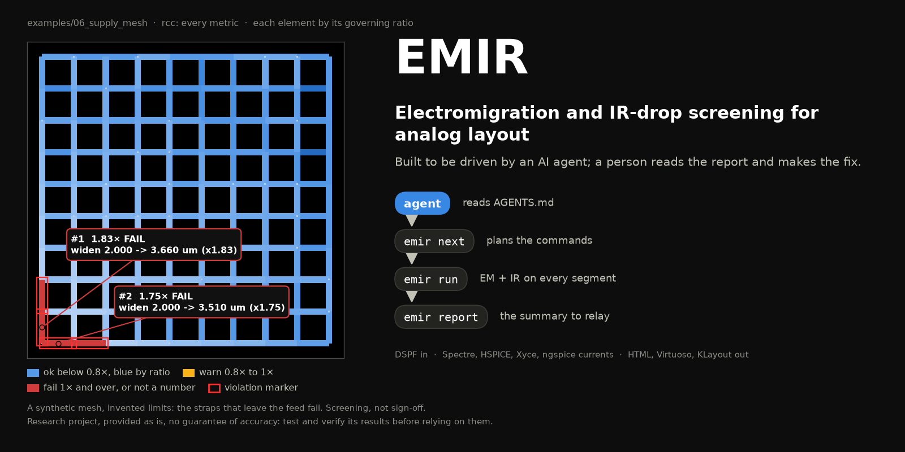

# EMIR

**EM and IR-drop screening for analog layout, built to be driven by an AI agent.** Point
your agent at this repository; it reads [AGENTS.md](AGENTS.md).

> **EMIR is a research project, provided as is, with no warranty or guarantee of
> accuracy. It is your responsibility to test and verify its results for your process,
> tools and design before relying on them.**

EMIR reads the resistor network of every net (a DSPF; on SKY130, magic extracts one from
the GDS), the currents that flow in it (a Spectre, HSPICE, Xyce or ngspice simulation, or
DC values) and your PDK's limits, checks every wire segment and via against its avg, rms
and peak limits, computes the IR drop on each supply, and says what to change: widen this
wire to that width, add that many cuts.

<picture>
  <source media="(prefers-color-scheme: light)" srcset="docs/images/hero_light.png">
  
</picture>

**Screening, not sign-off.** EMIR finds EM and IR problems early and tells you where to
look; foundry-qualified EM/IR analysis remains the sign-off flow. A simulator's route into
EMIR is proven on the machine that uses it (`emir verify-sim`): until it passes there,
every run from that simulator says it is not verified.

## Quickstart

From a clone, on Linux with Python 3.10 or newer:

```sh
python3 -m venv .venv && . .venv/bin/activate
pip install -e .
```

Then prove the install, screen the bundled sample, and read the report (a few seconds):

<!-- quickstart: tests/test_docs.py runs this block as written -->
```sh
emir selftest
emir run emir/data/sample/rail.dspf --process emir/data/sample/process.yaml \
    --currents '{"VDD": 0.004, "MP0:s": -0.001, "MP1:s": -0.001, "MP2:s": -0.001, "MP3:s": -0.001}' \
    --summary-out emir_out/summary.json --html emir_out/html
emir report --from emir_out/summary.json
```

The sample is a 60 um Metal1 rail with four 1 mA loads and invented limits, so every
number can be checked by hand. Its verdict is FAIL on purpose:

```text
| VDD | Rm1 | (2.500, 0.000) | Metal1 | wire | avg | 1.667x | Metal1: widen 0.750 -> 1.255 um (x1.67) |
| VDD | Rc3 | (60.000, 0.000) | Cont | via | avg | 1.333x | Cont: 1 -> 2 cuts (+1) |
- VDD: 54.000 mV (from the feed)
```

Then run `emir next` with your own files: it prints the commands to run, in order, with a
reason for each. An agent does the same through [AGENTS.md](AGENTS.md), or over MCP
(`emir mcp`); in Virtuoso, an EMIR menu and an Explorer highlight the worst segments
(UNVERIFIED until checked on site: [Cadence](docs/cadence.md)).

## How the currents are used

| currents | what is simulated | checks |
|---|---|---|
| a simulation (rcc) | the RC netlist, every branch current saved, over two or more periods of the activity (`--period`) | every metric: avg, rms, peak EM, static and dynamic IR, exactly, over the record's last whole periods |
| DC (`--currents`) | nothing | avg = rms = peak, and the IR drop: a screen |

`--mode rcc` is accepted and may be left out. Big blocks need the RC simulation in this
release, and on an ADC or PLL top it is expected to run long: a faster route is planned.
[Method and accuracy](docs/method.md) has the method and the evidence.

## Examples

Each runs offline from a clone (with the virtual environment active) with
`bash examples/<name>/run.sh`, and compares its results with golden files. There is no
`01`: the quickstart above is the first step ([examples/README.md](examples/README.md)).

| example | shows | needs |
|---|---|---|
| [`02_xyce`](examples/02_xyce/) | the open-simulator flow, rcc, on a rail worked out by hand | Xyce |
| [`03_ngspice`](examples/03_ngspice/) | the same circuit through ngspice | ngspice |
| [`06_supply_mesh`](examples/06_supply_mesh/) | a synthetic supply mesh screened with rcc, with invented limits that make a few straps fail | Xyce |
| [`08_open_layout`](examples/08_open_layout/) | a SKY130 layout on the magic route: magic's network, rcc branch by branch against the simulator | the `klayout` extra, a SKY130 PDK, a magic built with the `geoout` patch, Xyce or ngspice |
| [`09_cadence_flow`](examples/09_cadence_flow/) | what a Cadence site runs, offline: the extraction plan, save lines, the testbench | nothing more |
| [`10_mcp_agent`](examples/10_mcp_agent/) | a scripted MCP client following `emir_next` on the sample | the `mcp` extra |
| [`11_hspice_offline`](examples/11_hspice_offline/) | the HSPICE route on synthetic HSPICE ASCII and CSDF results (HSPICE itself is not run) | nothing more |

## Documentation

In [`docs/`](docs/) (it reads on GitHub as it is, and builds with MkDocs:
`pip install -e '.[docs]' && mkdocs serve`): [Getting started](docs/getting-started.md),
[Method and accuracy](docs/method.md), [Simulators](docs/simulators.md),
[Process files and extraction](docs/process-files.md), [Cadence](docs/cadence.md) and the
generated [Reference](docs/cli-reference.md). For agents: [AGENTS.md](AGENTS.md),
[agent/](agent/README.md) (playbooks, MCP, evals, the [contract](agent/CONTRACT.md) and the
[error codes](agent/errors.md)). Changes: [CHANGELOG.md](CHANGELOG.md).

## Licence and trademarks

EMIR is licensed under the MIT License ([`LICENSE`](LICENSE); [`NOTICE`](NOTICE) holds the
copyright line, the disclaimer, the credit for the code derived from other projects and the
trademark note). [`THIRD_PARTY_NOTICES.md`](THIRD_PARTY_NOTICES.md) lists the third-party
code and data; the process files in `pdks/` carry the open PDKs' own data (Apache-2.0).

Cadence, Virtuoso, Spectre, Quantus, PVS and OCEAN are trademarks of Cadence Design
Systems, Inc.; Calibre is a trademark of Siemens Industry Software Inc.; HSPICE and StarRC
are trademarks of Synopsys, Inc. EMIR is not affiliated with or endorsed by Cadence,
Siemens, Synopsys, or any foundry or PDK provider.
