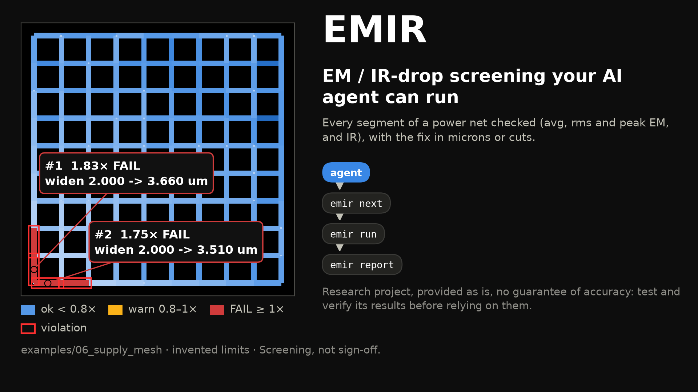
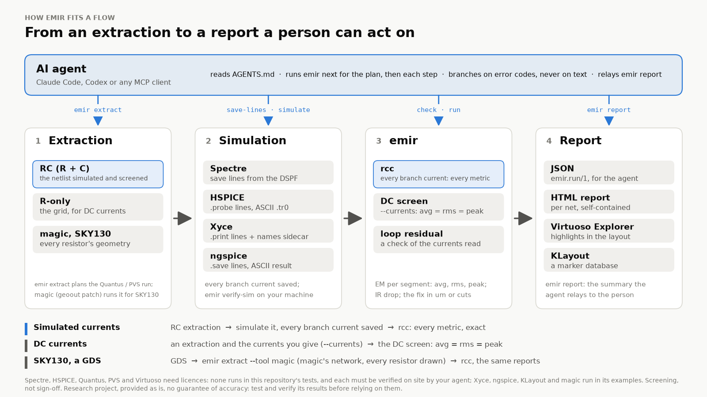
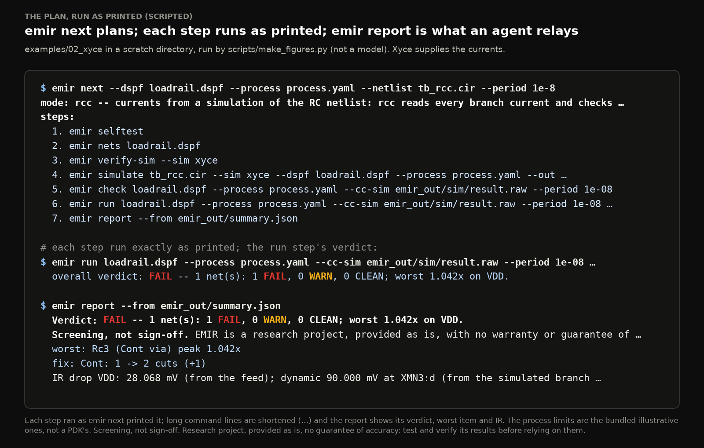
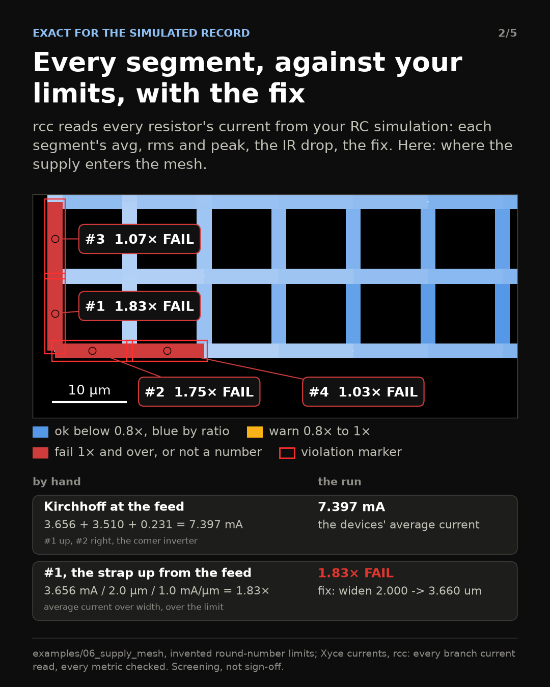
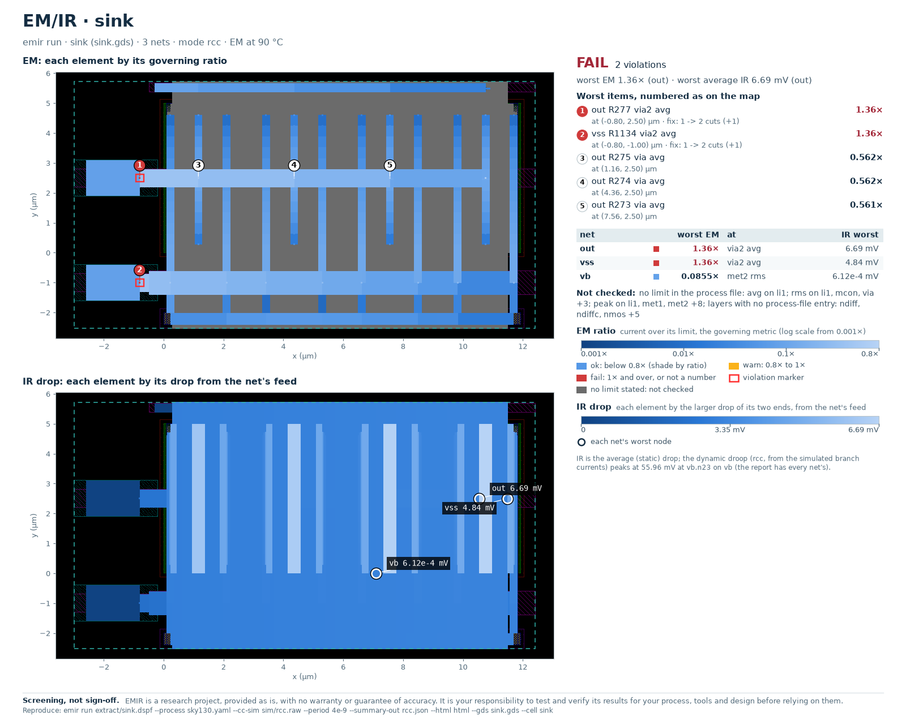

# EM/IR screening for analog layout, built for your AI agent



*A synthetic power mesh, invented limits (examples/06_supply_mesh).*

The electromigration (EM) and IR-drop check on an analog block usually comes last. By then the layout is done, and a sign-off run that finds a contact with one cut where it needed three is the most expensive place to find it. Most of the work before that run is bookkeeping: which currents, which limits, at which temperature, on which segment, and what to change.

<!-- maintainer: one sentence from your own experience here (a block where a late EM/IR fix cost you); not to be written by anyone else -->

I built EMIR to move that check earlier, and to make it something an AI agent can run for you.

## What EMIR is

EMIR reads the resistor network of each net (a DSPF from your extractor; on SKY130, from magic patched to write each resistor's geometry), a process file with your PDK's EM limits, and the currents (a Spectre, HSPICE, Xyce or ngspice simulation, or DC values). It checks every wire segment and via against its avg, rms and peak limits, computes the IR drop on each supply, and says what to change in a layout engineer's units: "Metal1: widen 2.000 -> 3.660 um". Results come as JSON, a report, a chart of the layout with the worst items numbered, HTML pages, KLayout markers and Virtuoso highlights.

It is a screening tool. Foundry-qualified EM/IR remains the sign-off flow; EMIR says where to look first and lists what it did not check. Every report says "Screening, not sign-off." It is also a research project, provided as is, with no guarantee of accuracy: test and verify its results before relying on them.



*How EMIR fits a flow.*

## Built for an agent first

An agent is good at bookkeeping when the tool says exactly what happened. So the interface is a contract, not a set of log lines.

- **One entry point.** AGENTS.md gives the preflight (`emir selftest`, offline), a playbook per task and the guardrails: never invent a limit or a current, never call a result sign-off, ask before a licensed tool or a long run.
- **The decision tree as code.** `emir next` prints the commands to run, in order, with reasons, what is missing and which steps need a person's go-ahead.
- **A contract.** The 19 commands answer in JSON, and 26 JSON schemas describe their documents and inputs. Every refusal and warning carries one of 210 stable codes (errors, warnings and notes) with a hint and the command that diagnoses it.
- **A report to relay.** `emir report` writes what the person reads: verdict, worst items with fixes, IR, where the currents and limits came from, what was not checked.
- **MCP and evals.** `emir mcp` serves the commands as typed tools, and 11 task cards with deterministic graders check that an agent ran the self-test first, asked before licensed tools and invented no limits.



*emir next's plan for examples/02_xyce, each step run as printed (scripted, not a model).*

## Exact: every branch current, every metric

When the currents come from a simulation, EMIR asks for the RC extraction itself in the testbench and for every resistor's current to be saved: `emir save-lines` writes those lines for Spectre, HSPICE, Xyce or ngspice, and `emir simulate` adds them to a copy of your testbench and runs the open simulators. EMIR then reads every branch current (rcc). Nothing is reconstructed: each segment's avg, rms and peak come from its own waveform, integrated over the record's last whole periods of the block's activity. rcc is exact for the simulated record over the whole periods you give (--period); whether the testbench has settled is yours to establish, as for any .meas. A run whose last two periods differ by more than 2 % on a branch that matters is refused, with no number. Walking a spanning tree from the feed turns the branch currents into node voltages, so static and dynamic IR come out of the same result; every branch off the tree checks them again, and a wrong DSPF, a missing save line or a flipped sign shows up in that loop residual instead of as a plausible number.

On example 02's invented rail, four NMOS sinks pulsing in turn, every number can be worked out by hand, and Xyce and ngspice land on it: the far contact has one cut where its 2.5 mA peak needs two, 1.042x its limit; the feed segments sit at 0.847x on their average; the IR drop is 28.07 mV on average currents, 90.0 mV at the instant the far sink is on. The two simulators agree to 1.1e-4.



*The feed corner of the cover's mesh, checked by hand (examples/06_supply_mesh, invented limits).*

The price is the simulation, and in this release every simulated block pays it: each resistor is an element of the RC transient, so on an ADC or PLL top the run is expected to be long and may converge poorly. `emir next` plans it as a long run, the agent asks before starting one, and a faster route for big blocks is planned. With no simulation yet, DC currents give a quick screen of your current budget: avg, rms and peak are then equal.

## From a GDS on SKY130

On SKY130, magic extracts the network from the layout, every resistor one drawn segment with its layer, width and place, and EMIR writes the DSPF that is also the RC netlist the testbench includes. The patch that makes magic write that geometry is public, and offered upstream to magic. On example 08's synthetic cell, four NMOS whose drain and source buses each reach a pad through a single via2 cut, magic extracted 1135 resistors; rcc read every one of them, equal to the simulator's own currents, and both rails fail on that cut at 1.36x: via2: 1 -> 2 cuts. The diffusion, poly and wells carry current too; the process file gives them no limit, so they are in the IR drop and reported as not checked.



*Example 08: magic's network, simulated with Xyce and screened with rcc (synthetic layout, the SKY130 limits of pdks/sky130.yaml).*

## Limits: from the PDK's files, or typed by hand

EMIR never guesses a limit. `pdks/sky130.yaml` is built only from SKY130's public files, and every value cites its file and line; what the PDK does not publish, such as peak limits, is reported as not checked. GF180MCU and IHP SG13G2 files are built the same way; only SKY130's has been run on layouts.

When the EM data is missing, or exists only as an encrypted file, the person types it from the design manual: `emir process new` writes a fill-in file for exactly the layers and vias a DSPF uses, each value empty with its unit and a slot for its source, and `emir process check` flags what is empty, unsourced or a likely unit slip (A for mA). Every report and chart then says which limits were typed by hand, and from which document.

## Cadence, and verification on site

EMIR needs no Cadence licence. At a Cadence site, `emir extract` plans PVS LVS and Quantus, extracting only after LVS matched and the person agreed (`--run`); `emir save-lines` writes the Spectre save statements; in Virtuoso, an Explorer highlights the worst segments on the layout, read-only.

None of these tools runs where EMIR is built, so nothing claims they work. Each simulator proves its own route on the machine that uses it: `emir verify-sim` runs small testbenches whose answers are known by hand through that simulator, there, and checks every branch current and its direction. Until it passes, every run from that simulator says it is not verified. The licensed routes stay unverified until your agent checks them on site, with your go-ahead for every licensed run.


*The HTML report of examples/02_xyce (Xyce currents, illustrative limits).*

## What it does not do

- Sign-off, or a lifetime model.
- Blech length, limit tables by width range, or thermal maps: one current density per layer and metric, at one temperature.
- Invent limits or currents: they are yours, and a metric without a limit is reported as not checked.
- Screen a chip from its blocks: a run screens one DSPF, one block or one top, as simulated.
- Claim results on real designs: the examples are synthetic or illustrative; only Linux is tested.

## Try it

```sh
git clone https://github.com/skycadeda/emir && cd emir
python3 -m venv .venv && . .venv/bin/activate && pip install -e '.[all]'
emir selftest
```

Then open your agent in that folder and ask it to screen a block, or connect an MCP client (`claude mcp add emir -- emir mcp`). EMIR is open source under the MIT licence. If you try it on your PDK, tell me what broke.

## Where the numbers come from

The rail worked out by hand: examples/02_xyce and 03_ngspice (Xyce 7.10, development build; ngspice 45); the SKY130 layout: examples/08_open_layout; the cover and the sample fix: examples/06_supply_mesh; each checked against golden results. Counts: the package itself. Images: scripts/make_figures.py, from these runs.

*Cadence, Virtuoso, Spectre, Quantus and PVS are trademarks of Cadence Design Systems, Inc.; HSPICE is a trademark of Synopsys, Inc. EMIR is not affiliated with or endorsed by Cadence, Synopsys or any foundry or PDK provider.*
