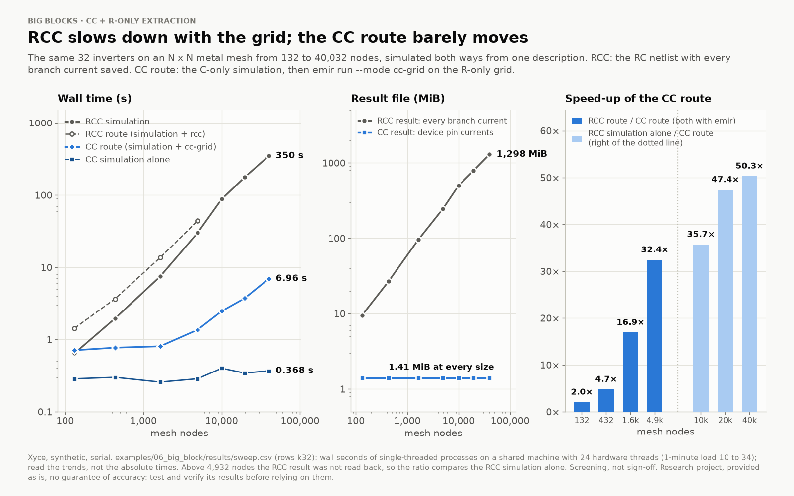
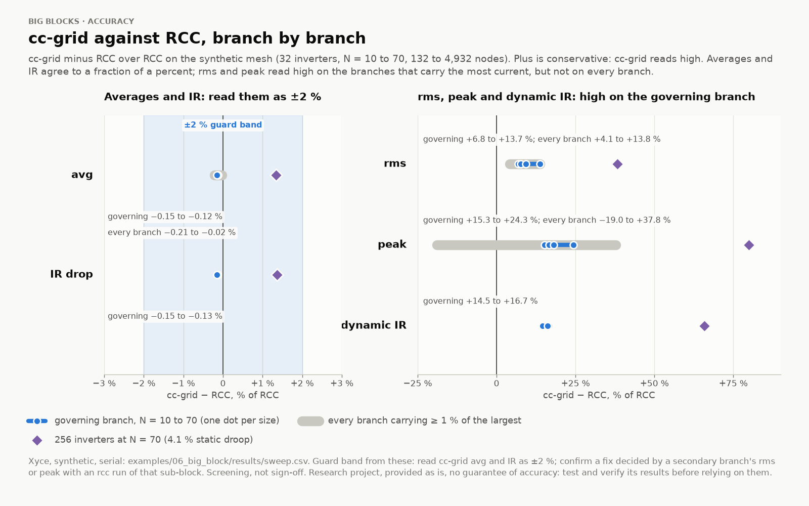
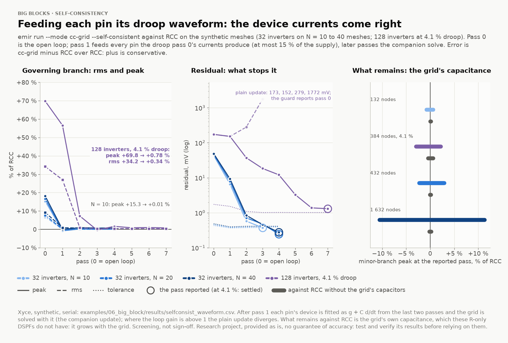
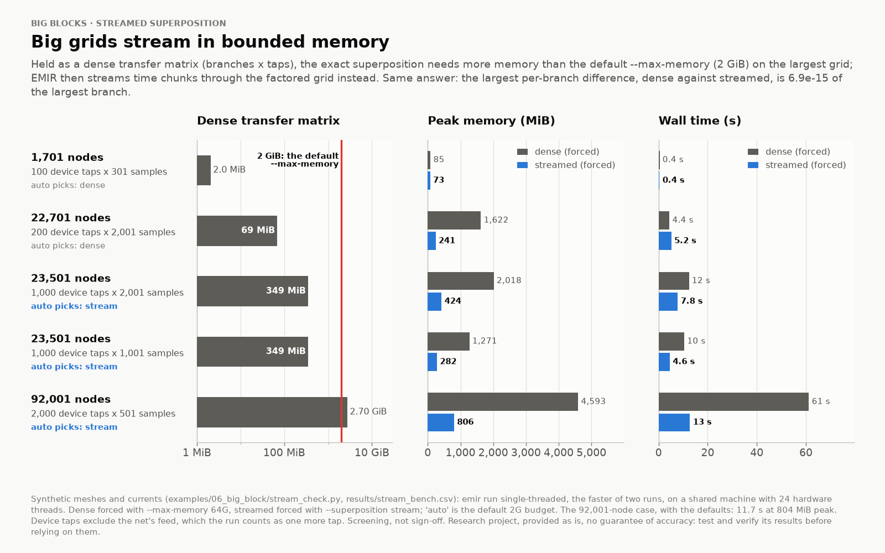
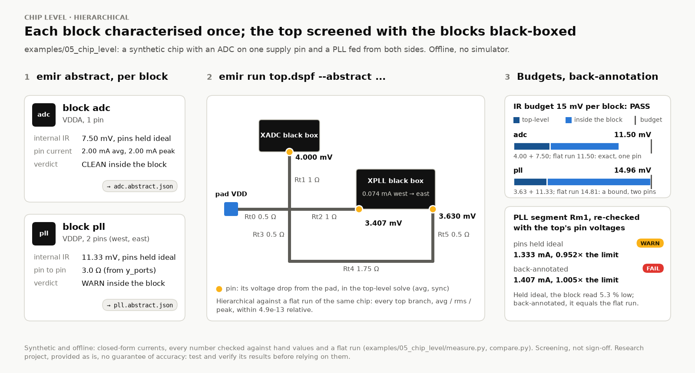

# EM/IR screening for analog layout, built for your AI agent


*A synthetic power mesh, invented limits (examples/06_big_block).*

The electromigration (EM) and IR-drop check on an analog block usually comes last. By then the layout is done, and a sign-off run that finds a contact with one cut where it needed three is the most expensive place to find it. On an ADC or PLL top it is worse: the RC transient that saves every resistor current is slow and often does not converge, so the check slips to chip level.

<!-- maintainer: one sentence from your own experience here (a block where a late EM/IR fix cost you); not to be written by anyone else -->

I built EMIR to move that check earlier, and to make it something an AI agent can run for you.

## What EMIR is

EMIR reads the resistor network of each net (a DSPF from your extractor; on SKY130, from magic patched to write each resistor's geometry), a process file with your PDK's EM limits, and the currents (a Spectre, HSPICE, Xyce or ngspice result, or DC values). It checks every wire segment and via against its avg, rms and peak limits, computes the IR drop on each supply, and says what to change in a layout engineer's units: "Metal1: widen 2.000 -> 3.655 um". Results come as JSON, a report, a chart of the layout with the worst items numbered, HTML pages, KLayout markers and Virtuoso highlights.

It is a screening tool. Foundry-qualified EM/IR remains the sign-off flow; EMIR says where to look first and lists what it did not check. Every report says "Screening, not sign-off." It is also a research project, with no guarantee of accuracy: test and verify its results before relying on them.


*How EMIR fits a flow.*

## Built for an agent first

The hard part of an EM/IR screen is the bookkeeping; an agent does it well when the tool says exactly what happened.

- **One entry point.** AGENTS.md gives the preflight (`emir selftest`, offline), a playbook per task and the guardrails: never invent a limit or a current, never choose the mode, never call a result sign-off, ask before a licensed tool or a long run.
- **The decision tree as code.** `emir next` prints the commands to run, in order, with reasons, what is missing and which steps need a person's go-ahead.
- **The person chooses the mode.** When currents come from a simulation, rcc or cc-grid is your call: `emir next` shows both, and the self-consistent variant, with measured cost and accuracy, and plans nothing more until you choose. The agent asks; it never picks.
- **A contract.** The 21 commands answer in JSON, and 30 JSON schemas describe their documents and inputs. Every refusal and warning carries one of 311 stable codes (errors, warnings and notes) with a hint and the command that diagnoses it.
- **Verified where it runs.** Each simulator must pass `emir verify-sim`, a hand-checkable testbench, on the machine that uses it; until then its runs say they are unverified.
- **A report to relay.** `emir report` writes what the person reads: verdict, worst items with fixes, IR, where the currents and limits came from, what was not checked.
- **MCP and evals.** `emir mcp` serves the commands as typed tools. Sixteen task cards with deterministic graders check that an agent ran the self-test first, asked for the mode and invented no limits.


*emir next's plan for examples/02_xyce, each step run as printed (scripted, not a model).*

## Big blocks: a CC simulation and an R-only grid

For an ADC or PLL top, the CC route simulates the block from a C-only extraction (each rail one ideal node), saves each device's supply-pin current, and pushes those through the R-only grid by superposition: one sparse LU factorisation.

I ran both routes on the same 32 inverters on an N x N rail mesh, from 132 to 40,032 nodes (Xyce, synthetic, serial):

- The RCC simulation went from 0.64 s to 350 s. The whole CC route, simulation plus emir, took 6.96 s at the largest.
- The RCC result grew from 9.52 MiB to 1,298 MiB; the CC result was 1.41 MiB at every size.
- The RCC route took 2.0x as long as the CC route at 132 nodes, 16.9x at 1,632 and 32.4x at 4,932; at 40,032 nodes the RCC simulation alone took 50.3x as long as the whole CC route.

For a small block RC is still right: exact and cheap. That RCC on production power nets runs 10 to 100 times slower is my experience, not a measurement here.



*RCC against CC + cc-grid. Read the trends, not the absolute times.*

The price is decoupling: the CC simulation's devices never see the droop. On the branch that decides the verdict (N = 10 to 70), cc-grid read avg and IR 0.12 to 0.15 % low, and rms and peak 7 to 24 % high, the safe direction. Lighter branches are not always safe (peak down to 19 % below RCC), and the error grows with droop: with eight times the devices (4.1 % droop), peak read 80 % high. Hence the docs' guard band: read avg and IR as ±2 %, and confirm a fix that a secondary branch decides with an rcc run.



*cc-grid against RCC, branch by branch.*

With `--dynamic`, the decaps an ideal rail leaves idle are put back: on example 13's single-rail meshes, decap-free read the feed branch's rms 25 to 52 % high and missed the decaps' straps, decap-aware read it 0.6 to 5.3 % high. The default basis, worst, keeps the larger per segment; it is no bound between two resistive rails (straps 5.52 % low).

## Closing the loop, and what it does not close

`--self-consistent` feeds the droop back: each pass re-simulates the CC testbench with every device pin fed its own droop waveform, until the droop the currents produce is the droop they were fed. It is the person's call. It runs on Xyce and ngspice here; the Spectre and HSPICE routes must be verified on site by your agent.

Where a load's current follows its supply and the block's other rail is ideal, it lands on the closed-loop answer: in example 12 (resistive loads) the IR drop went from 108.000 mV open loop to 100.050 mV, against 100.050 mV from RCC. On switching inverters, whose spikes the ideal rail makes too high and too narrow, it took the governing branch's peak from 15 to 18 % high to within 0.7 % of RCC in four or five simulations (0.38 to 0.55 % droop), and, on a smaller mesh at the same 4.1 % droop (128 inverters, 384 nodes), from +69.8 % to +0.78 % in eight.

What it leaves is the grid's own capacitance: scored on the R-only grid, minor branches read within 0.77 % of RCC on 132 nodes, up to 11.3 % off on 1,632, and within 0.2 % of RCC without the grid's capacitors. On grids this small it costs more than RCC (31.3 s against a 1.9 s RCC simulation at 4.1 % droop); the pay-off on a big block is an extrapolation, not a measurement. Above about 2 % droop, report both results side by side.



*The waveform loop on switching inverters (Xyce, synthetic, serial).*

## Streaming: no memory wall

Exact rms and peak need each branch's response to each tap over time. As a dense transfer matrix, a 92,001-node grid with 2,000 taps needs 2.70 GiB. EMIR streams time chunks through the factored grid instead, keeping running sums per branch. With the defaults that case ran in 11.7 s at 804 MiB peak; the dense path, forced with a 64 GiB budget, took 61.2 s and 4,593 MiB. The two agree to 7e-15 of the largest branch current.



*Dense against streamed: the same currents, in bounded memory.*

## Chip level, hierarchically

`emir abstract` characterises each block once: its pin currents with the pins held ideal, the Norton equivalent of its grid, its internal IR drop. The top is screened with the blocks black-boxed, and each block gets an IR budget: the top-level drop at its worst pin plus its own. A block fed at several pins is re-checked with the top's pin voltages. On the synthetic chip of examples/05_chip_level:

- the hierarchical run equals a flat run of the same network to 5e-13, relative;
- the ADC's budget, 4.00 + 7.50 = 11.50 mV, equals the flat worst droop; the PLL, fed from two sides, gets 14.96 mV, an upper bound on the flat 14.81 mV;
- a PLL segment read 0.952x its limit (WARN) with ideal pins and 1.005x (FAIL) back-annotated.



*Chip-level EM/IR, hierarchically (synthetic, offline).*

## Limits: from the PDK's files, or typed by hand

EMIR never guesses a limit. `pdks/sky130.yaml` is built only from SKY130's public files, and every value cites its file and line; what the PDK does not publish, such as peak limits, is reported as not checked. GF180MCU and IHP SG13G2 files are built the same way; only SKY130's has been run on layouts.

When the EM data is missing, or only an encrypted ICT, the person types it from the design manual: `emir process new` writes a fill-in file for exactly the layers and vias a DSPF uses, each value empty with its unit and a slot for its source, and `emir process check` flags what is empty, unsourced or a likely unit slip (A for mA). Every report and chart then says which limits were typed by hand, and from which document.

## Cadence

EMIR needs no Cadence licence. At a Cadence site, `emir extract` plans PVS LVS and Quantus, extracting only after LVS matched and the person agreed (`--run`); in Virtuoso, an Explorer highlights the worst segments on the layout. None of these tools runs where EMIR is built: each must be verified on site by your agent.

## What it does not do

- Sign-off, or a lifetime model.
- Blech length, limit tables by width range, or thermal maps: one current density per layer and metric, at one temperature.
- Invent limits or currents, or choose rcc or cc-grid: they are yours, and a metric without a limit is reported as not checked.
- Place coupling-capacitor current on the grid in cc-grid: a C-only extraction gives it no position.
- Bound the self-consistent answer: it is accurate, not conservative.
- Claim speed on real designs: the figures come from synthetic meshes; only Linux is tested.

## Try it

```sh
git clone https://github.com/skycadeda/emir && cd emir
python3 -m venv .venv && . .venv/bin/activate && pip install -e '.[all]'
emir selftest
```

Then open your agent in that folder and ask it to screen a block, or connect an MCP client (`claude mcp add emir -- emir mcp`). EMIR is open source under the MIT licence. If you try it on your PDK, tell me what broke.

## Where the numbers come from

Big blocks: examples/06_big_block/results, sweep.csv and selfconsist_waveform.csv, and examples/13_decap_aware/results/decap.csv (Xyce 7.10, synthetic meshes, single-threaded, a shared machine). The cover and the sample fix, chip level and the closed loop: examples 06, 05 and 12, each checked against golden results. Counts: the package itself. Images: scripts/make_figures.py, from these runs.

*Cadence, Virtuoso, Spectre, Quantus and PVS are trademarks of Cadence Design Systems, Inc.; HSPICE is a trademark of Synopsys, Inc. EMIR is not affiliated with or endorsed by Cadence, Synopsys or any foundry or PDK provider.*
