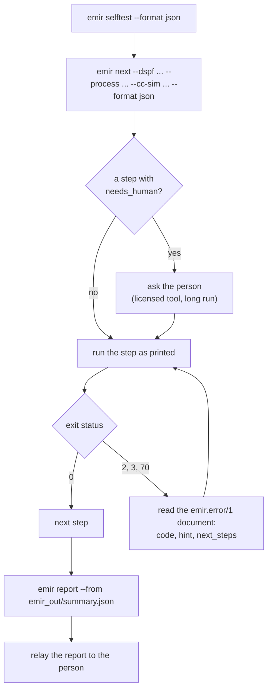

# Driving EMIR from an agent

EMIR's primary user is an AI agent; people are the second audience, who run it by hand
sometimes and read what the agent reports. This page is the human's view of how an
agent drives it, so you know what to expect and what to check. The agent's own
instructions are in the repository:

| file | what it is |
|---|---|
| [`AGENTS.md`](../AGENTS.md) | what an agent reads first (Codex, Claude Code through `CLAUDE.md`, Cursor and others): what EMIR is, the preflight, the decision tree, the guardrails, the reporting contract |
| [`agent/README.md`](../agent/README.md) | how to connect an agent: Claude Code, Codex, Cursor, MCP clients |
| [`agent/CONTRACT.md`](../agent/CONTRACT.md) | the machine contract: JSON documents, exit codes, error codes, `next_steps`, `emir next`, the schemas |
| [`agent/playbooks/`](../agent/playbooks/) | step-by-step playbooks, one per task (below) |
| [`agent/errors.md`](../agent/errors.md) | every error code, generated from the registry |
| [`agent/schemas/`](../agent/schemas/) | the JSON Schema of every document EMIR reads or writes |

The playbooks:

| playbook | for |
|---|---|
| [`00-preflight.md`](../agent/playbooks/00-preflight.md) | prove the install and find the tools, before touching user data |
| [`01-screen-a-block.md`](../agent/playbooks/01-screen-a-block.md) | a DSPF and a simulation result, the common case |
| [`02-big-block-cc.md`](../agent/playbooks/02-big-block-cc.md) | an ADC or PLL top: CC simulation and R-only extraction ([Big blocks](big-blocks.md)) |
| [`03-chip-level-hierarchy.md`](../agent/playbooks/03-chip-level-hierarchy.md) | a chip from its blocks' pins and currents ([Chip level](chip-level.md)) |
| [`04-onboard-a-pdk.md`](../agent/playbooks/04-onboard-a-pdk.md) | a process file for a new PDK ([Onboarding a PDK](pdk-onboarding.md)); with no readable file (the ICT missing or encrypted), the EM data typed by the person ([Entering EM data by hand](pdk-onboarding.md#entering-em-data-by-hand)) |
| [`05-open-source-flow.md`](../agent/playbooks/05-open-source-flow.md) | Xyce or ngspice ([Open-source flow](open-source-flow.md)) |
| [`06-cadence-flow.md`](../agent/playbooks/06-cadence-flow.md) | PVS, Quantus, Spectre and Virtuoso ([Cadence flow](cadence.md)); HSPICE ([Simulators](simulators.md)) |
| [`07-report-to-human.md`](../agent/playbooks/07-report-to-human.md) | what to tell the person, from `emir report` |
| [`08-troubleshooting.md`](../agent/playbooks/08-troubleshooting.md) | by error code |
| [`09-gds-only.md`](../agent/playbooks/09-gds-only.md) | only a layout on an open PDK: magic extracts the DSPF (`emir extract --tool magic`) |
| [`10-mcp.md`](../agent/playbooks/10-mcp.md) | EMIR as MCP tools |

## How an agent runs EMIR

1. **Preflight.** `emir selftest` proves the install; `emir info` says which tools are
   found.
2. **Plan.** `emir next` takes what the agent has (`--dspf`, `--process`, `--cc-sim`,
   `--netlist`, `--currents`, `--gds`, `--abstract` ...) and prints the commands to
   run, in order, each with its reason. Its decision tree is code, the same rules the
   playbooks describe, so the tool and the documentation cannot drift. Each step says
   whether it needs a human (`needs_human`: a licensed tool, a long run, or the person's
   choice), and a `waiting` step names the placeholders to fill from earlier steps. When
   a simulation drives the run and no `--mode` was given, the first step is
   `choose-mode`: the agent shows the person the routes it lists (rcc, cc-grid, cc-grid
   self-consistent, each with its measured cost and accuracy) and asks; it never picks.
3. **Run each step as printed**, with `--format json`, and stop at the first that
   exits non-zero.
4. **Branch on codes, never on message text.** Every refusal, failure and warning
   carries a stable code `EMIR-Exxx` / `EMIR-Wxxx` / `EMIR-Ixxx` with a hint and the
   exact command that fixes or diagnoses it (`emir explain <code>`).
5. **Report.** `emir report --from 
` writes the summary a person reads.

*emir next's plan for examples/02_xyce, each step run exactly as printed (scripted by scripts/make_figures.py).*

## The machine contract, in short

- **One JSON document per command.** With `--format json`, stdout carries exactly one
  document whose `schema` field names it (`emir.run/1`, `emir.check/1`,
  `emir.error/1` ...); logs go to stderr. `emir schema <name>` prints its JSON Schema.
  A number that could not be computed is `null`, and a reader must report it as "not
  a number", never as 0.
- **Exit status.** 0 done (for `emir check`: inputs OK); 1 a FAIL verdict, an IR
  budget FAIL, or an EM basis asked for and not computed (`em_basis.honoured` false),
  with `--fail-on-violation`; 2 bad input or refused; 3 a required tool or package is
  missing; 70 internal error, failed self-test or validation; 130 interrupted; 143
  terminated. Never interactive, never a prompt.
- **`next_steps`**: every document carries the commands that come next, runnable as
  printed: after `emir check`, the run; after a run, the report and, on a FAIL, the
  HTML and the re-run; after an error, the command that fixes or diagnoses it. An emir
  command keeps the caller's `--format` (except a run's `emir report` step, whose
  Markdown is what to relay); a step that is not an emir command (`ls`, `klayout`)
  carries `"shell": true`.
- **The run summary** (`emir.run/1`): the verdict, the worst items with their fixes,
  per-net mode, governing metric, IR, dynamic IR, what was not checked, the input
  check's findings, the notices raised during the run, and the disclaimer
  "Screening, not sign-off."

## The reporting contract

`emir report --from emir_out/summary.json` writes, in this order: the verdict line and
"Screening, not sign-off."; the command that ran and when; the mode, the current
source, the temperature, the process file and the DSPF; the nets; the worst items with
their fixes in the engineer's units; the IR per power net; where the limits came from
(per layer and via: entered by hand, imported from an ICT or the PDK's public data, and
from which document); what was **not checked**; the input-check warnings; the warnings
raised during the run; and the closing screening line. An agent relays that, and does not paraphrase numbers into new ones.
See the example in [Getting started](getting-started.md#the-first-run).

## Guardrails an agent follows

- Never invent a process limit: a missing limit is "not checked", and the report says
  so.
- Never call a result sign-off.
- Ask the person before running a licensed tool (Spectre, HSPICE, Quantus, PVS) or
  anything `emir next` marks as a long run.
- Verify a simulator's route on the machine that uses it (`emir verify-sim`) before the
  first run that relies on it; a run from an unverified simulator says so (EMIR-W464).
- Relay with every result that EMIR is a research project, provided as is, with no
  guarantee of accuracy, and that the person tests and verifies its results.
- Never start, kill or restart the person's Virtuoso or simulator, and never edit the
  layout: the viewers only highlight, and open layouts read-only.
- Respect the person's limit on concurrent simulations.

## EMIR as MCP tools: `emir mcp`

For MCP clients (Claude Code, Claude Desktop, Codex, Cursor and others that speak the
Model Context Protocol over stdio), `emir mcp` serves EMIR as typed tools. Install the
`mcp` extra (`pip install -e '.[mcp]'`, the official MCP Python SDK 1.19 or newer;
both its 1.x and 2.x lines work), then add the server to the client, for example
`claude mcp add emir -- emir mcp`. [`agent/mcp/`](../agent/mcp/) has the snippets for
each client, and `emir mcp --list` prints them with this machine's absolute path to
`emir` (it works without the SDK).

What the client gets:

- **One tool per command**, `emir_<command>` (`emir_run`, `emir_check`, `emir_next`,
  `emir_save_lines` ...), whose parameters are the command's own options, taken from
  its parser, so a tool cannot drift from the CLI. A call returns the same document
  `emir <command> --format json` prints, as structured content and as JSON text;
  `isError` is true exactly when it is `emir.error/1`. Arguments are the tool's
  parameter names exactly: an unknown one (a misspelt option, `--from` for
  `from_file`) or a missing required one is refused with `EMIR-E592`, and nothing runs.
- **`emir_cli`**, which runs one emir command line as printed in a `next_steps`; anything
  that is not an emir command is refused (`EMIR-E591`). Over MCP, each `emir next` step
  also carries the tool call that reproduces it.
- **Resources**: the error catalog (`emir://catalog/errors.md`), every JSON Schema
  (`emir://schema/<name>.json`) and, from a clone, `AGENTS.md`, `agent/README.md` and
  the playbooks.
- **The go-ahead rule**: a call that would start a licensed tool (`emir_run` with
  `netlist` or `self_consistent`), run long (a DSPF above the 50 000-node big-block
  threshold of `emir next`, or `dynamic` with `dyn_steps` above 200000), rewrite a file in place (`emir_import_ict` without
  `out`), or loosen the EM verdict (`emir_run` with an `em_basis` other than the
  default, or `dynamic` with `ground`, with `dyn_steps` below 2000 or without
  `period`) is refused with `EMIR-E590` unless it carries `confirm: true`. Nothing runs;
  the agent asks the person and passes `confirm: true` only after they agree.

The server runs one call at a time, keeps its stdout for the protocol (logs go to
stderr), and exits 0 when the client closes stdin, 143 on SIGTERM and 130 on SIGINT.
It is not a sandbox: it runs as you and reads and writes where the commands do. Long
runs report no progress, and a client's cancellation does not stop a command already
running.

Measured: the MCP tests pass on SDK releases 1.19.0, 1.30.0, 2.0.0 and 2.2.0
(`scripts/mcp_sdk_matrix.sh`); a TypeScript SDK client (1.31.0) validated every tool's
output against its advertised schema; Claude Code 2.1.287, headless, called
`emir_selftest` and reported it passed. The last two were one-off checks on the
development machine, not in the repository. Claude Desktop, Codex and Cursor
configurations follow those clients' published formats and were not run.
[`examples/10_mcp_agent`](../examples/10_mcp_agent/) is a scripted client session you
can run offline.
