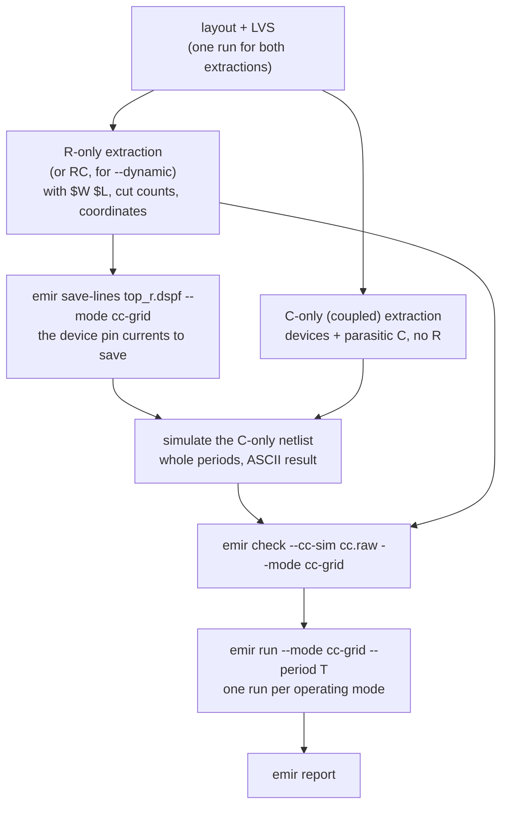

# Big blocks: CC simulation + R-only extraction

An ADC top or a PLL top is too big for the direct route. Simulating its RC-extracted
netlist with every branch current saved (RCC) is slow, often fails to converge, and
writes a result with one current per resistor per time step. For these blocks EMIR
simulates **C-only** and pushes the device currents through the **R-only** grid
afterwards (`--mode cc-grid`). This page explains why RCC struggles, gives the
recipe, says what the method assumes and misses, and how accurate it is, with the
source of every number.

**Screening, not sign-off.** Everything on this page screens a layout and says where
to look; foundry-qualified EM/IR remains the sign-off flow.

> **In short.** On a synthetic mesh at 40,032 nodes the whole CC route took 7 s where
> the RCC simulation took 350 s. On the branch that decides the verdict, cc-grid read
> avg and IR within 0.15 % of RCC (slightly low), and rms and peak 7 % to 24 % high.
> Read cc-grid avg and IR as ±2 %, and confirm with an rcc run any fix that a secondary
> branch's rms or peak decides. A 92,001-node grid with 2,000 device taps streams in
> 11.7 s at 804 MiB with the defaults. Every number below has its source.

## Why RCC is slow and convergence-prone

Four effects add up. Each was probed in this repository on a synthetic mesh with
Xyce (`examples/06_big_block`, results in `results/sweep.md`); how large they are on
a production power net is a claim from experience, below.

1. **Node count.** Every extracted sub-node of the rails is an unknown of the
   simulator's matrix, inside every Newton iteration of every time step, while the
   device count stays the same. From N = 10 to N = 200 (132 to 40 032 nodes, the same
   32 inverters) the RCC simulation went from 0.644 s to 350 s, 0.22 to 334 ms per
   accepted step; the CC simulation stayed between 0.257 and 0.399 s.
2. **Stiffness from tiny resistances.** Milliohm segments next to femtofarad caps put
   very short time constants into the matrix. At N = 40, 2.5 mohm segments instead of
   0.25 ohm raised the RCC simulation's failed time steps from 156 to 223 (+43 %),
   but it took fewer accepted steps (1 796 against 1 942) and its wall time did not
   grow (7.07 s against 7.45 s, run back to back): on this mesh the effect is on the
   step control, not yet on the run time.
3. **The save list.** RCC needs one current per resistor per time step. The RCC
   result grew from 9.52 MiB at N = 10 to 1 298 MiB at N = 200 (ASCII, about 16 bytes
   per saved value); at N = 200 the same simulation saving nothing took 294 s against
   350 s, and saving the node voltages instead 280 s. A projection, not a
   measurement: a million-resistor rail over 100 000 steps would write about 1.6 TB
   at that density. The CC result holds one current per device supply pin and does
   not grow with the mesh (1.41 MiB at every size, 32 currents).
4. **Devices multiply it.** At N = 70, 256 inverters instead of 32 took the RCC
   simulation from 30.1 s (1 631 steps) to 59.6 s (3 108 steps): the time steps the
   devices need are steps of the whole grid too. The CC simulation went from 0.286 s
   to 1.98 s.

The same trend was measured with Spectre at the original development site. On a
generated inverter-bank test rail, refining the rail from 41 to 2 057 nodes while the
CC netlist stayed the same took the RCC run from 1.92 s to 9.53 s, while CC + grid
went from 1.97 s to 2.61 s: 3.65 times faster at 2 057 nodes, and growing with the
node count. On an extracted OTA (249 nodes) RCC took 1.00 s against 0.81 s for CC
(1.23 times), and the C-only extraction 2.7 s against 11.1 s for the RC one: at that
size the direct route is the better one.

What practitioners report for production power nets, that RCC transients commonly run
10 to 100 times slower than CC simulations and often fail to converge, is experience,
**not measured here**. The conditioning problem shows up early, though: at the
original development site, a Spectre transient of an R-extracted netlist of a variant
of the same OTA (249 nodes, 280 resistors, conservative error settings) already
reported pivoting problems in its DC solution (plus a topology notice for 65 dangling
sub-nodes, which any R extraction has).


*RCC against CC + cc-grid on a synthetic mesh (Xyce, synthetic, serial).*

## The recipe



Always:

- **One layout and one LVS run for both extractions**, so the instance names in the
  CC result match the R-only DSPF's `*|I` records.
- **R-only** (or RC, for `--dynamic`) with geometry (`$W $L`), via (`$N` or `$A`)
  annotation and node coordinates; see [DSPF requirements](dspf-requirements.md).
- `--mode cc-grid`, the person's choice: `emir next` without `--mode` shows the routes
  with their measured cost and accuracy and recommends cc-grid at this size, where RCC
  transients converge poorly and slowly; it never picks for them.
- **Whole periods of a settled operating point**, `--period` given; check the window
  sensitivity the run prints.
- **One EM run per operating mode** (below).

```sh
emir next --dspf top_r.dspf --process pdk.yaml --format json      # choose-mode: ask the person
emir next --dspf top_r.dspf --process pdk.yaml --mode cc-grid --format json
emir save-lines top_r.dspf --mode cc-grid --prefix XTOP. --format json
# simulate the C-only netlist with those saves, ASCII output
emir check top_r.dspf --process pdk.yaml --cc-sim cc.raw --mode cc-grid --period T --format json
emir run top_r.dspf --process pdk.yaml --cc-sim cc.raw --mode cc-grid --period T \
    --summary-out emir_out/summary.json --format json
emir report --from emir_out/summary.json
```

With Xyce or ngspice, `emir simulate` writes the save lines into a copy of the
testbench and runs it ([Open-source flow](open-source-flow.md)); with Spectre,
`emir save-lines top_r.dspf --mode cc-grid --out emir_save.scs` writes the include
file ([Cadence flow](cadence.md)).

## PSS or transient

The window must hold whole periods of a settled, repeating activity:

- **PLL top, locked integer-N.** The loop is periodic at the reference period once
  locked: use PSS with that period (or the common period of every clock in the block,
  when other clocks run too), with enough harmonics (`EMIR-W404` warns on
  truncation), and read its **time-domain** output: it gives exact rms and peak and
  feeds `--dynamic`. The harmonic output gives per-pin scalars only, so rms and peak
  become in-phase upper bounds and there is no dynamic IR. `--period` = the PSS
  period.
- **PLL top, fractional-N.** The divider sequence repeats only after the modulator's
  pattern, which can be long: use a transient over a whole number of those
  repetitions (choose a fractional word with a short repetition for the EM run),
  `--period` = the repetition; check the window sensitivity.
- **ADC top.** Use a coherent stimulus: an input at M/N of the sample rate with M and
  N coprime, so the record repeats every N conversions; simulate a whole number of
  records after start-up, `--period` = N / f_s.

## Operating modes

Screen each operating mode on its own and never average one result across them. EM
does depend on the long-term average, but the right combination would be weighted by
the mission profile (how long the part spends in each mode); a simulation that mixes
modes weights them by simulated time instead, and screening each mode at full duty is
the conservative choice: start-up and acquisition, calibration, steady state,
standby and power-down each draw differently, and the worst one decides. For a PLL:
acquisition (a transient, not periodic), locked steady state, band calibration,
power-down. For an ADC: conversion,
calibration, standby. Screen the reference nets and the clock drivers' supplies too:
EM applies to every net that carries current, and `--net all` (the default) covers
them.

## How cc-grid scales: dense or streamed superposition

The **dense** path builds the transfer matrix `T` (branches x taps): one
back-substitution per tap, then `T @ W(t)` in time chunks. It takes
`8 x branches x taps` bytes; the chunks are sized so that the matrix and the chunk's
temporaries stay inside `--max-memory` together.

The **streamed** path never builds `T`. For each chunk of time samples it forms the
injection columns `B = P W(t_chunk)`, solves `G U = B` with the same factorisation (a
multi-column back-substitution, in blocks of 8 columns), forms the branch currents
`g_e (U_a - U_b)` and accumulates, per branch, the weighted sum of `I`, of `I^2`, and
the running max of `|I|`. Its memory is one chunk, at most 64 samples wide; its solve
count is the number of time samples instead of the number of taps. By linearity the
two paths give the same answer.

`--superposition auto` (the default) streams when the dense matrix would exceed
`--max-memory` (default `2G`, 2 GiB), and also when the result has fewer than twice as many
time samples as taps, where streaming is the cheaper path. `dense` and `stream` force
a path (dense only within the budget: above it the run streams and warns,
`EMIR-W452`). A budget above 80 % of the machine's physical memory is lowered to that
(`EMIR-W550`). The run summary records what ran and why (`nets[].superposition`:
`dense` or `stream` for the exact superposition, `scalar` for per-tap in-phase bounds,
`combined` for blocks aligned `async` or by a phase sweep), and `EMIR-I450` says when it
streamed.

Measured in this repository (`examples/06_big_block/stream_check.py`: synthetic
meshes, emir single-threaded, the faster of two runs, on a shared machine whose
1-minute load average is in the first table; "dense" ran with `--max-memory 64G` so it
never streams, "auto" with the default `2G`, 2 GiB). The cases:

| case | nodes | resistors | device taps (+1 feed) | samples | dense matrix | auto picks | load |
|---|---|---|---|---|---|---|---|
| s40_k100_t301 | 1 701 | 3 221 | 100 | 301 | 2.5 MiB | dense | 10 |
| s150_k200_t2001 | 22 701 | 44 901 | 200 | 2 001 | 69 MiB | dense | 10 |
| s150_k1000_t2001 | 23 501 | 45 701 | 1 000 | 2 001 | 349 MiB | stream | 15 |
| s150_k1000_t1001 | 23 501 | 45 701 | 1 000 | 1 001 | 349 MiB | stream | 19 |
| s300_k2000_t501 | 92 001 | 181 401 | 2 000 | 501 | 2.70 GiB | stream | 26 |

Their time and memory, each path forced, then the default:

| case | dense s | dense peak MiB | streamed s | streamed peak MiB | auto s | max difference |
|---|---|---|---|---|---|---|
| s40_k100_t301 | 0.4 | 85 | 0.4 | 73 | 0.4 | 1.5e-15 |
| s150_k200_t2001 | 4.4 | 1 622 | 5.2 | 241 | 4.3 | 4.8e-15 |
| s150_k1000_t2001 | 12.4 | 2 018 | 7.8 | 424 | 7.7 | 4.0e-15 |
| s150_k1000_t1001 | 10.5 | 1 271 | 4.6 | 282 | 4.4 | 4.6e-15 |
| s300_k2000_t501 | 61.2 | 4 593 | 12.8 | 806 | 11.7 | 6.9e-15 |

"device taps" counts the device pins; the run adds the net's feed as one more tap
(its summary says `taps` 1 001 for 1 000 device taps), and `auto` decides on that
count: row `s150_k1000_t2001` streams because 2 001 samples is below 2 x 1 001 taps,
as its run says. The last row is the case a dense-only path cannot hold under a 2 GiB
budget: `auto` streams it in 11.7 s at 804 MiB peak, where the dense path, given
`--max-memory 64G` (64 GiB) to prove the point, took 61.2 s and 4 593 MiB. "max difference" is the largest per-branch
difference between the dense and the streamed currents over avg, rms and peak,
relative to the largest branch value.


*Streamed superposition: the same currents as the dense matrix, in bounded memory (synthetic meshes).*

## Assumptions and blind spots

- **Decoupling (no droop feedback).** The devices draw their current from an ideal
  rail. To first order they draw more than they would from the drooped rail, so
  cc-grid is pessimistic; but it is a first-order argument, not a guarantee. On the
  synthetic mesh here the **average** came out slightly **below** RCC on every branch
  (governing branch -0.12 % to -0.15 % for N = 10 to 70, every branch between -0.21 %
  and -0.02 %). Two probes at N = 40 point at gate-overlap (Miller) charge flowing
  through the device contact resistance: with the contact made 1 mohm the governing
  branch's average error went from -0.13 % to -0.017 %, and with no gate-overlap
  capacitance to -0.023 % (rows `contact0` and `nooverlap` of the sweep). This
  explanation is inferred from those two rows, not proven. Keep a guard band.
- **rms and peak on secondary branches.** The open-loop currents are larger and better
  aligned than the real ones, which makes rms and peak conservative on the branches
  that carry the most; on branches carrying a fraction of the largest current the
  redistribution can go either way (synthetic mesh, N = 10 to 70: rms stayed
  conservative on every branch, +4.13 % to +13.80 %; peak was +15.28 % to +24.29 % on
  the governing branch and at least +10.45 % on the major ones, but went down to
  -17.15 % on secondary branches and -18.95 % on minor ones).
- **Coupling-cap current has no position.** A C-only extraction collapses each net to
  a node, so the current a signal-to-rail coupling cap injects has nowhere on the grid
  to enter. Device pins escape this only because their `*|I` records carry
  coordinates. Fine while coupling currents are small; a genuine limit when they are
  not.
- **Decap currents.** On an ideal rail a decap sees no dV/dt and carries no current,
  so the CC simulation attributes all of the transient demand to the grid: pessimistic on
  the feed path, but a decap's straps and the branches around it carry none of the
  decap's current (measured in example 13: the straps -100 %, minor branches down to
  -96 % rms), and it makes `--dynamic`'s decap additive (not counted twice). `--dynamic`
  computes the decap-aware currents, and the verdict's basis is the person's choice
  ([Decap-aware EM](#decap-aware-em)).
- **Names must match.** The C-only and R-only extractions must come from the same
  extractor and LVS run, so the instance names in the CC result match the R-only
  DSPF's `*|I` records. A schematic simulation names devices differently (`M7`
  against `MM7`, finger suffixes): not recommended (this naming claim is from the
  development notes, not checked here).
- **A pin reaching the net at several places** (`*|I` records with one terminal)
  cannot be split from one saved current: the check refuses it (`EMIR-E417`). Screen
  such a net in rcc mode (a sub-block), extract each connection as its own terminal,
  or use the [hierarchical flow](chip-level.md).
- **Memory outside the superposition.** The tap waveforms (taps x points x 8 bytes),
  the DSPF and the result file are held in memory; on the 92 k-node case the whole
  default run peaked at 804 MiB (806 MiB forced to stream), of which the chunk's
  working set is about 445 MiB (64 samples of 7.0 MiB each, `bytes_per_sample` in
  `emir/bigblock.py`).
- **An RCC reference must be R + C.** An R-only simulation has none of the
  capacitance the RC-extracted block's currents charge: it is not RCC, and cc-grid
  scored against it measures something else.

## Measured accuracy, and the guard band

| where | what | avg | rms | peak | IR | dynamic IR |
|---|---|---|---|---|---|---|
| this repository: synthetic mesh, Xyce, N = 10 to 70 (`examples/06_big_block/results/sweep.csv`) | governing branch | -0.12 % to -0.15 % | +6.83 % to +13.68 % | +15.28 % to +24.29 % | -0.15 % to -0.13 % | +14.49 % to +16.66 % (open loop) |
| the same | every branch (1 % of the largest and up) | -0.21 % to -0.02 % | +4.13 % to +13.80 % | -18.95 % to +37.75 % | | |
| the same, 256 inverters at N = 70 (4.1 % static droop) | governing branch | +1.34 % | +38.21 % | +79.90 % | +1.36 % | +65.89 % (open loop) |
| original development site, a generated inverter-bank test rail (Spectre) | largest branch error | +1.5 % | +2.6 % | +11.1 % | +1.81 % | +12.0 % (open loop) |

Plus is conservative (cc-grid above RCC). The original development site's row measures
the method; the tools named there are how the numbers were made, not a claim that they
work with EMIR anywhere: that is UNVERIFIED until checked on the machine that runs them
(`emir verify-sim`). The
recommendation, from these:

- Treat cc-grid **avg ratios and IR drops as +-2 %**: call a segment within 2 % of its
  limit marginal, not clean. The default warn fraction (0.8) already flags it as WARN.
- **rms and peak** are conservative on the branches that carry the most current, but
  not on every branch: where a secondary branch's rms or peak decides a fix, confirm it
  with an rcc run of that sub-block.
- **Dynamic IR** is open loop and was conservative in every measurement above; report
  it as open loop: conservative in every case measured, not a guaranteed bound.
- When a power net's IR drop exceeds **about 2 % of its supply** (static, or dynamic
  when `--dynamic` ran: rms and peak follow the dynamic droop), the open-loop error
  grows: the average read +1.34 % at 4.1 % on the synthetic mesh (and +1.53 % at 2.1 %
  droop on the inverter-bank rail at the original development site), rms and peak far
  more. Report the value as open loop -- its rms and peak conservative on the governing
  branch in every case measured on a supply net, its avg and IR not always (-0.17 % at
  4.19 % droop in four phases), not a bound on every branch -- and offer the
  self-consistent run (below: it brings the device currents to RCC's; what it leaves is
  the grid's own capacitance).
- **A signal net is not a supply.** Part of its current charges its own wire
  capacitance, which cc-grid's branches, scored on the R-only grid, do not carry. On
  example 08's gate net vb (a layout magic extracted) the open loop read the governing
  branch's rms +1.34 % and peak +5.31 %, and the loop, with the gate's drop fed back,
  rms -6.55 % and peak -4.68 % (`examples/08_open_layout/README.md`): neither is a bound
  there. Confirm a signal net's result that matters with rcc.


*cc-grid against RCC, branch by branch (Xyce, synthetic, serial).*

## Self-consistency

The CC simulation's one approximation is the ideal rail: every device draws its current
from the undropped supply, and on an extracted grid the supply at each pin moves, in time
with the currents. `--mode cc-grid --self-consistent` closes that loop with Xyce or
ngspice (measured), or Spectre or HSPICE (UNVERIFIED until checked on site): pass 0 is the
open loop; each pass after it feeds every instance pin its own droop waveform, solved on
the DSPF's grid over the whole transient (R-only, or RC when the DSPF has capacitance on
the net, with the decaps the process file's `cap_models` size, each behind its access
resistance), and simulates the CC testbench again, until the
droop the currents produce is the droop they were fed
([Methods and modes](method-modes.md#closing-the-loop-self-consistency) says how, what
each simulator needs, and why the companion update is there). Each pass is a CC
simulation, so it stays a CC-sized job; it re-simulates, so it is the person's call. One
net by default; `--net VDD,VSS` closes both rails together.

**What the open loop gets wrong, and why.** On the synthetic inverter meshes, the open
loop's rms and peak read high (+6.8 % and +15.3 % on 132 nodes, +34 % and +70 % at 4.1 %
droop) because the ideal rail makes every device's spike too high and too narrow: its own
contact resistor degenerates its source, its neighbours switching in the same phase pull
the grid down at the same instant, and the idle inverters beside it (each a 200 fF load
behind its ON PMOS: a decap) give charge back. On these meshes (2 fF of grid capacitance
per node) it is not the grid's capacitance: removing every grid capacitor from RCC moved
the open loop's governing branch by under 0.7 points up to 432 nodes (the `--nocap` rows
of the results).

Measured with Xyce on the synthetic meshes (`examples/06_big_block/selfconsist.py`,
committed as `results/selfconsist_waveform.csv` and `.md`), the governing branch against
RCC, open loop -> the reported pass:

| case | droop | avg | rms | peak | minor-branch peak | simulations | loop / RCC simulation |
|---|---|---|---|---|---|---|---|
| 32 inverters, 132 nodes | 0.38 % | -0.12 % -> -0.02 % | +6.83 % -> +0.02 % | +15.28 % -> +0.01 % | -0.77 % to +0.63 % | 4 | 3.3 s / 0.5 s |
| 32 inverters, 432 nodes | 0.47 % | -0.12 % -> -0.03 % | +7.68 % -> +0.07 % | +16.59 % -> +0.08 % | -2.34 % to +2.94 % | 5 | 4.9 s / 1.3 s |
| 32 inverters, 432 nodes, four phases | 0.47 % | -0.14 % -> -0.02 % | +8.47 % -> +0.07 % | +19.28 % -> +0.07 % | -4.63 % to +3.53 % | 4 | 2.1 s / 0.9 s |
| 128 inverters, 384 nodes | 4.14 % | +1.01 % -> +0.01 % | +34.16 % -> +0.34 % | +69.78 % -> +0.78 % | -2.98 % to +2.19 % | 8 (settled) | 31.3 s / 1.9 s |
| 128 inverters, 384 nodes, 1.5 ohm segments | 7.94 % | +3.80 % -> +0.06 % | +50.46 % -> +0.36 % | +113.85 % -> +1.31 % | -4.10 % to +3.03 % | 10 (settled) | 35.3 s / 1.9 s |
| 32 inverters, 1 632 nodes | 0.55 % | -0.13 % -> -0.04 % | +9.21 % -> +0.67 % | +18.11 % -> +0.67 % | -10.55 % to +11.29 % | 5 | 8.1 s / 5.3 s |

![Three charts. Against the pass, the governing branch's peak and rms error fall from up to 70 % to within 1 % of RCC by pass 2 on the 32-inverter meshes, and at 4.1 % droop to within 2 % from pass 3 on (0.78 % at the reported pass, 7); the residual falls under its tolerance after 4 or 5 simulations, and at 4.1 % droop levels off at about 1.3 times it, where the answer no longer moves, while the plain update grows and is stopped; at the reported pass, the minor branches' peak error widens with the grid against RCC and stays within about 1 % against RCC without the grid's capacitors.](images/selfconsist_waveform.png#only-light)
![Three charts. Against the pass, the governing branch's peak and rms error fall from up to 70 % to within 1 % of RCC by pass 2 on the 32-inverter meshes, and at 4.1 % droop to within 2 % from pass 3 on (0.78 % at the reported pass, 7); the residual falls under its tolerance after 4 or 5 simulations, and at 4.1 % droop levels off at about 1.3 times it, where the answer no longer moves, while the plain update grows and is stopped; at the reported pass, the minor branches' peak error widens with the grid against RCC and stays within about 1 % against RCC without the grid's capacitors.](images/selfconsist_waveform_dark.png#only-dark)

*What feeding each pin its droop waveform does on switching inverters (Xyce, synthetic, serial): rms and peak come to within about 1 % of RCC on the governing branch; what remains is the grid's own capacitance.*

What it fixes and what it does not, on this evidence:

- **It brings the device currents to RCC's.** Each device's own peak current lands within
  1.3 % of RCC's on every mesh with 2 fF a node, and fed back from an RC DSPF (reading low
  at high droop: median -0.5 % to -1.1 % at 4 %; from an R-only DSPF with 20 fF a node,
  down to -4.8 %, below), and the governing branch's avg, rms and peak within 0.14 % on
  one net up to 432 nodes at low droop and reltol 1e-4 (+0.53 % rms at 1e-3, `EMIR-W540`; VSS, closed with VDD on 264 nodes: its peak +0.45
  %, its window from 0), +0.01 %, +0.34 % and +0.78 % at 4.1 % droop, up to +1.31 %
  (peak) at 7.9 %.
- **It leaves the grid's own capacitance.** The branch currents are scored on the R-only
  grid, and what the grid's capacitance does to them grows with the grid: the minor
  branches (1-10 % of the largest) read within 0.8 % of RCC on 132 nodes, 3.1 % on 432
  (4.7 % with four phases) and 11.3 % on 1 632 nodes (and the governing rms +0.67 %
  there). Against RCC simulated without the grid's capacitors the same results are within
  0.3 % (2.2 % at 4 % droop): the loop has done its part. And an R-only DSPF has no
  capacitance to feed back (`EMIR-W544` on every such run): with ten times the grid
  capacitance (20 fF a node) the devices' peaks read 1.1 % to 4.8 % low and minor
  branches down to -20 %; the RC DSPF of the same mesh fed back takes the devices to
  within 0.1 %, and `--dynamic --em-basis decap-aware` scores its branches through the RC
  grid: minor branches within 0.52 % of RCC, where scored on the R-only grid they read
  -19.5 % to +25.3 % (`EMIR-W545`; `hd16b_c20`, `hd16b_c20rc` in the results). The
  default basis with `--dynamic`, worst, takes per segment the larger of the two: it keeps
  the R-only grid's high readings (the governing branch +1.98 % rms and +3.88 % peak there,
  minor branches up to +25.3 %), conservative rather than accurate. Scored on the R-only
  grid or decap-aware, the answer is accurate rather than conservative, so a minor branch
  or a device can read a few percent low, more on a bigger grid or one with more
  capacitance.
- **It feeds back the decaps.** The capacitor devices and MOS decaps the process file's
  `cap_models` size are in the grid the droop is solved on, each MOS decap behind its
  access resistance, as `--dynamic` models them. On the 4.1 % droop mesh with 8 decaps of
  5 pF behind 2 ohm (`examples/13_decap_aware/results/decap_loop.md`) the loop converged
  in 6 simulations and, scored decap-aware, read every branch class, and the straps' rms
  and peak, within 1.2 % of RCC and the devices within 0.05 % (the open loop: the devices +15 % to +28 %,
  the straps +50 % to +52 % rms and +63 % to +70 % peak); the worst basis kept the R-only
  grid's +23.5 % rms and +55.7 % peak on the governing branch. One that `cap_models`
  cannot size is left out (`EMIR-W547`): the droop fed back is then deeper than the real
  one, so the devices read low (-5.87 % to -1.00 % with all 8 left out), the governing
  branch high (+13.90 % rms, +31.94 % peak) and the decaps' straps are not checked. A
  decap whose device the testbench simulates (its pin fed by the split) loads the grid
  through that pin instead, and is not added twice, but the loop converges slower: with
  one of the 8 simulated it stopped at its default pass limit (`EMIR-W407`, the open loop
  reported) and settled in 11 simulations at `--max-passes 16`, the devices within
  0.05 %, the simulated decap's own peak current and its strap's -5.94 %.
- **Resistive and bias loads land on rcc** when the block's other rails are ideal or closed
  in the same loop (`emir verify-sim`'s self-consistent case and example 12, to 1e-9 in 3
  simulations).
- **The loop it replaced** fed back each pin's average droop and over-corrected switching
  CMOS: it took the governing branch's average from +1.34 % to -2.02 % of RCC at 4.1 %
  droop (no longer conservative) and left about three quarters of the rms and peak error
  (`results/selfconsist.csv`, kept as its record).

**What it costs, and where it pays.** On grids this small the loop costs more than RCC:
each pass is a CC simulation with 2.64 to 3.29 times the open loop's time points on the
32-inverter meshes on Xyce at reltol 1e-4 (the PWL breakpoints; 1.7 to 3.8 over every
one-net case at reltol 1e-4 with the companion update, up to 6.1 with the plain one, which
diverged; 4.3 to 4.9 at 1e-3, and a 40 ns transient took about 9.5
times the open loop's simulation time a pass), plus the grid side
(0.1 s to 0.9 s a pass on 132 to 432 nodes, 0.6 s to 1.0 s on 1 632). On a big block the CC simulation does not grow with the grid (0.25 s to 0.40 s at
every size of the sweep above), while RCC does (30 s at 4 932 nodes, 350 s at 40 032):
the loop should pay off there, but that is an extrapolation, not a measurement in this
repository, and the grid side grows with the grid (one back-substitution per time step,
streamed in time chunks).

At the original development site (a measurement from elsewhere, not reproducible here,
made with the average-droop loop), on a generated inverter-bank test rail at 2.1 % droop
with Spectre, three passes moved the governing-branch error from +1.53 % to -0.05 %, peak
from +11.1 % to +7.6 %, and the dynamic droop error from +12.0 % to +7.3 %.

When a power net's droop is above about 2 % of its supply, report the open-loop value as
open loop (rms and peak conservative on the governing branch in every case measured on a
supply net, avg and IR not always, not a bound on every branch nor on a signal net), offer
the self-consistent run, and report its result next to it, labelled.
An open-loop cc-grid run given `--vdd` warns there (`EMIR-W520`) and plans the loop in its
`next_steps` (marked `needs_human`).

## Dynamic IR (`--dynamic`)

The static solve gives the average droop; a supply spec is written against the
instantaneous one. `--dynamic` integrates `C dV/dt + G V = I(t)` on a uniform step
(trapezoidal; the matrix factorises once), with:

- the DSPF's own capacitance (an RC extraction of the rails; coupling caps are taken
  as AC ground, which is optimistic for a far net that swings in phase);
- capacitor devices sized from the process file's `cap_models` (`cj`, `cjsw`), and MOS
  decaps as `R_access + C` branches (`cox`, and `esr_a/esr_w/esr_l` or `ron_sq`): a
  decap is only as good as its access resistance;
- the CC pin waveforms as the drive.

The window is a whole number of periods, so the RC state is taken to **periodic
steady state**: the window is integrated again from where the previous pass ended
until a pass ends where it started (to 1e-4 of its worst excursion). Starting from
the DC solution instead adds a start-up transient the circuit does not have (in the
tests, a cosine into an R || C node at wRC = 1 starts at its DC solution, 41 % above
the steady amplitude, and that start is what a single pass reports). The droop is
**open loop**: the CC currents come from an ideal rail and do not react to it. It
read high in every case measured above, but it is not a guaranteed bound: it would be
one only if the currents were, and open-loop currents are not (a minor branch's peak
read down to -18.95 %, in the table above). With `--self-consistent` the currents are
those of the loop's reported pass, each pin fed its droop waveform (the RC grid's when the
DSPF has capacitance on the net), and the report, the chart's note and `dynamic.source`
say which pass (open loop when the loop reported pass 0). An R-only DSPF carries no
capacitance: then the run says so (`EMIR-W450`) and the static results stand.

Tested against the validation suite's closed forms through `emir run --dynamic`
(`tests/test_bigblock.py`): an R || C node driven by a sinusoid at wRC = 0.1, 1 and
10, and a decap with and without 50 ohm of access resistance, each within 0.5 %.

In rcc mode the dynamic droop comes from the measured branch currents and needs no
option.

The same integration gives the decap-aware EM below. Its passes carry the wrap (a pass
restarts from the injection its end state is consistent with), restart a slow pass from
its corrected mean, and refine the steps where the waveforms or a fast decap need it (next
section), so the droop too is taken from them; a W411 warning then says when a waveform
feature kept less than 99 % of its own height on the steps.

## Decap-aware EM

On the ideal rail of the CC simulation a decap sees no dV/dt and carries no current, so
the static superposition charges every edge of the load current to the grid from the
feed: a board with its bypass capacitors unsoldered. The dynamic solve above (`--dynamic`)
has them soldered in, and the same steps give every grid resistor's current, `i = g (V_a - V_b)`,
reduced to rms and peak per segment as it runs (memory O(branches)). With `--dynamic` the EM
verdict then uses one of three bases, the default in [Options](#options) (without it, the
static one: a net with decap devices says so, EMIR-W428):

| `--em-basis` | rms and peak from | |
|---|---|---|
| `worst` | per segment and metric the larger of the two | a segment passes only if it passes with and without its decaps; on the feed path it is decap-free's numbers (high), on a decap's straps decap-aware's |
| `decap-free` | the static superposition: the verdict without `--dynamic` | high on the feed path, nothing on a decap's straps |
| `decap-aware` | the dynamic solve | rests on the decap model and the extraction's capacitance |

avg is the static one in every basis (a capacitor carries no DC; the solve's own average
checks the periodic steady state through `G Vbar = Ibar - C (V_N - V_0)/T`). The verdict,
the worst items, the HTML map and the viewers follow the basis; the summary keeps every
basis's verdict, worst ratio and segment (`nets[].dynamic_em.bases`) and every listed
segment's ratio in each basis (`ratio_decap_free`, `ratio_decap_aware`, `ratio_worst`,
`decided_by`). Which basis decides is the person's choice: the report names it in its
headline and the Nets table, its "Decap-aware EM" section follows the Nets table, and when
the bases disagree it lists the choices; `emir next --run-summary <summary>` plans that
choice (`choose-em-basis`, needs_human) and, given `--em-basis`, the re-run. A basis
other than the default warns (EMIR-W437); over MCP it needs `confirm` (EMIR-E590).

**Numerics** (each tested against an exact reference, `tests/test_decap.py` and
`tests/test_decap_steps.py`):

- **The steps follow the input and the decaps** (`dynir.StepSequence`). The default grid
  is four steps per interval of the result's samples, a whole multiple of them, so evenly
  spaced samples are grid points. Where the grid's chord misses a waveform feature (an
  edge, a spike's tip) by more than 1e-3 of its pin's own largest current, the interval is
  halved, again and again down to the feature (each level one more factorisation, up to 16
  levels within 1 GiB of them): on the grid alone, a 10 ps spike on a pin whose largest
  current is a slow pulse, in a 1 us window at 453 ps steps, would read its decap strap
  low with nothing to flag it. The step after a change of the input's slope is refined while the
  trapezoidal rule could ring on a decap faster than it (A-stable but not L-stable: at a
  144 ps step a 24 ps decap's feed read above the load's own peak, which no passive
  network can do); the bound uses the
  stiff part of the decaps' time constants as each pin sees them,
  `[(G + mC)^-1 G (G + mC)^-1 C 1]` with `m = 2/h` (the Elmore delay with each mode
  weighted by `(l/(l + m))^2`: two back-substitutions for every pin), so a wire-cap mesh
  refines nothing. The steps then grow back at most twofold every three steps. A decap lump
  is folded onto its node only when its access R C is below a tenth of the finest step
  taken (folded against the grid step instead, a lump whose 3 ps R C is below a 4 ps
  grid step would lose its ESR while the sub-steps resolve 3 ps spikes, and the feed
  would read low).
- **What the steps lose, like with like.** The sums are exact for a current linear between
  points; each pin's AC rms on the steps is compared with its AC rms on the simulator's own
  samples, both reduced the same way, and the worst pin's factor scales every segment (1
  to rounding when the steps resolve the waveforms; above 2 % EMIR-W435, above 10 % near the
  warn fraction the larger basis stands in). The static decap-free rms is the trapezoid of
  x^2 on the samples, which reads a sparsely sampled flank high (a triangle sampled at its
  corners 18.6 % high): taken for a loss of the step, that would inflate decap-aware's
  rms and repeat EMIR-W435 at every step count. Compared like with like, a decap-aware
  current never reads above the static decap-free one by that convention alone.
- **When the steps cannot carry it**, decap-aware EM is not computed (EMIR-W434): a
  feature kept below 99 % of its own height at the finest level or past the refinement's
  budget (3 x the grid's steps, or more on a small net), or the feed's current above the
  load's own on the same steps (a passive RC network only low-passes it:
  `numerics.feed_check`). The run gives the `--dyn-steps` that resolves it, never fewer (a
  smaller one would repeat the refusal), up to 2 000 000 (`decap.DYN_STEPS_MAX`, a design
  choice); past that it gives none and says so, for the person to judge the feature.
- **A negligible feature never counts.** One whose charge and energy (the integral of
  i^2) beyond the grid's chord are both below 1e-6 of its pin's per period
  (`dynir.NEGLIGIBLE`, a design choice) is left unresolved and said (EMIR-W429,
  `numerics.features_ignored`): it moves the droop, the averages and a branch's rms^2 by
  no more than that share of the pin's, so it does not refuse decap-aware EM. Its own
  peak, for less than the finest step, is not in the decap-aware currents: a 2 fs, 6 mA
  spike (1.7e-9 of its pin's charge per period) leaves a decap's strap without its 5.0 mA
  sliver, the feed within 0.5 % and the strap's rms^2 within 1e-6 of the pin's
  (`tests/test_decap_steps.py`). Counted, such a feature would refuse decap-aware EM and
  ask for a `--dyn-steps` no run could take.
- The periodic steady state carries the wrap (a pass restarts from the last sample's
  injection; restarting from the first's made the trapezoid's (-1)^n mode ring on nodes
  without capacitance) and restarts a slow pass from its corrected mean (each mode then
  contracts by at most 0.30 a pass); the averages are checked to 1e-4.
- Against closed forms: a feed resistor into wire C and a decap with series R within
  1e-4 (`emir validate`, "decap-aware EM"), the decap folded onto its node and a decap on
  its own strap within 1e-3; a ladder driven by 10 ps spikes within 0.2 % (rms) and
  -0.5 % .. +1 % (peak) of its matrix-exponential reference; a one-state decap's feed and
  strap within 0.5 % of their exact periodic steady state under each of the cases above.

**Measured against RCC on Xyce** ([`examples/13_decap_aware`](../examples/13_decap_aware/),
`results/decap.md`; example 06's mesh with 32 inverters and decaps of 5 pF on 0.5 ohm
straps, the same R and C in the RCC deck and in `cap_models`; relative, + is
conservative):

| case | decap-free rms / peak, governing | decap-aware rms / peak, governing | decap-aware, every class and the straps | decap-free, the straps |
|---|---|---|---|---|
| N = 20, no added decap | +7.68 % / +16.59 % | +7.63 % / +15.64 % | rms +4.79 .. +8.03 %, peak +8.57 .. +20.87 % | |
| N = 20, 8 decaps, 2 ohm | +29.60 % / +47.81 % | +3.80 % / +10.12 % | rms +2.49 .. +13.94 %, peak +6.97 .. +20.56 % | -100 % |
| N = 40, 16 decaps, 2 ohm | +44.42 % / +79.06 % | +1.69 % / +7.80 % | rms +1.17 .. +12.97 %, peak +3.75 .. +21.98 % | -100 % |
| N = 40, 16 decaps, 20 ohm | +25.42 % / +37.14 % | +5.31 % / +13.10 % | rms +2.13 .. +14.63 %, peak +8.79 .. +25.14 % | -100 % |
| N = 70, 32 decaps, 2 ohm | +52.27 % / +110.95 % | +0.59 % / +5.46 % | rms +0.39 .. +12.13 %, peak +2.16 .. +23.99 % | -100 % |
| N = 70, 32 decaps, 20 ohm | +38.43 % / +58.34 % | +3.55 % / +11.14 % | rms +1.34 .. +14.08 %, peak +6.10 .. +23.30 % | -100 % |
| N = 20, 8 decaps between two resistive rails | +41.95 % / +75.73 % | +13.67 % / +30.92 % | rms -5.52 .. +14.18 % (straps -5.52 .. -0.88 %), peak +3.80 .. +42.02 % | -100 % |

With decaps, decap-free reads the feed path 25 % to 52 % high in rms and a decap's straps
not at all, and minor branches down to -96 %: it is not conservative everywhere.
Decap-aware brings the governing branch to the open-loop band of cc-grid (+0.59 % to
+5.31 % rms, against +7.63 % without decaps at N = 20). The solver alone (Xyce on the same
RC network driven by the same CC currents; the two N = 20 cases, with and without decaps):
rms within -0.01 % .. +0.00 %, peak within -0.03 % .. +0.05 %, on every branch class; on
another mesh or load it can differ, and the run's own numerics (`peak_retention`,
`feed_check`, `correction_max`) say what its steps kept. The dynamic solve with
decap-aware EM took 1.3 s to 9.7 s from N = 20 to N = 70 on one thread
(`results/decap.csv`).

**What decap-aware does not cover:**

- **Open loop**, like every cc-grid number: it removes decap-free's pessimism, not the
  open loop's; it read high on every branch class measured with one resistive rail, which
  is not a guaranteed bound. With `--self-consistent` it scores the loop's reported pass
  instead, whose droop fed back holds the decaps `cap_models` size (each behind its
  access resistance; one it cannot size is left out, `EMIR-W547`, and the loop then reads
  low).
- **The decap model decides the number.** `cap_models` (`cox`: a MOS decap's largest C,
  which falls with bias; `cj`, `cjsw`) and the access resistance (`esr_*` fitted per
  finger at `esr_fit_freq`, or `ron_sq L / W / 6`, known to read it several-fold high and
  so the straps' current low): too much C or too little ESR makes decap-aware optimistic
  on the feed path. EMIR-W438 flags the closed-form access resistance, the `default` cap
  model, an ESR fitted far from the window, and coupling above 25 % of the capacitance.
- **Two resistive rails.** Each net is solved alone, with a decap's other plate an ideal
  AC ground; in the circuit both rails move, so the current through a decap between two
  resistive rails and its straps reads low (by up to `(R_this + R_other) / R_this` below
  its corner frequency; -5.52 % rms on the straps and -3.81 % on a minor branch in the
  measurement above), and `worst`
  is not a bound there (EMIR-W439).
- **Coupling to a signal net** is not counted as decap (its current flows from the ideal
  rail in the CC simulation, through no pin): its share is reported and the droop keeps
  it as an AC ground (EMIR-I431).
- A MOS decap whose drain, source and bulk are on the solved net attaches half at each
  channel end. A decap whose access R C is below a tenth of the finest step is folded onto
  its node: its ESR is dropped there (`decaps.folded_F` reports the share, EMIR-W438 names
  them). A decap on the feed node itself carries nothing (`capacitance.on_feed_F`). Decap
  lists binned with `lump_decap` are not used for EM.
- One ideal feed per net (the first port): segments at other ports of a multi-port net are
  fed from the first, and the feed current reported is the total there. No package or
  bond-wire inductance.
- Not computed (the verdict is decap-free there, `em_basis.fallback` says why): no
  capacitance or a harmonic result (EMIR-W450, as for the droop), no feed (W430),
  `--ground` not the feed (W431), not at periodic steady state (W432), a window not whole
  periods (W433), a step too coarse (W434). Under the default basis that is not the
  verdict asked for: the summary's `em_basis.honoured` is false (`not_computed` lists the
  nets and reasons), `--fail-on-violation` exits 1, the report's headline says the verdict
  is decap-free there, and `emir next --run-summary` plans the fix as the person's step.
  Without `--dynamic` at all, a net with decap devices says that its static verdict does
  not cover their straps (EMIR-W428), and `emir next --run-summary` plans the same run
  with `--dynamic` as the person's step (`rerun-with-dynamic`).
- Decaps `cap_models` cannot size (a model with no `cox`, as `emir process new` leaves it
  until the person fills it; a capacitor device with no model) are left out of the solve,
  so their straps carry nothing (EMIR-W409, W410): the net's `em_basis.decaps_not_sized`
  counts them, a basis that needs decap-aware EM is not honoured there (`not_computed`:
  decaps-not-sized; `--fail-on-violation` exits 1), and `emir next --run-summary` asks the
  person for the value. `emir process check --dspf` and `emir check --dynamic` warn
  before the run. Every decap whose straps the verdict does not cover is listed under the
  summary's `not_checked.decap_straps_not_covered` (and the report's and the chart's Not
  checked). Not for block abstracts (`--dynamic` is
  refused with `--abstract`, EMIR-E811; run the block itself). rcc mode measures the decaps' currents (`used: measured`).

## What `emir next` advises

On a DSPF above the big-block size (`thresholds.big_block_nodes`, 50 000 nodes: a
heuristic, not a measurement), the plan's `advice` carries this recipe as short lines
(rule `bigblock`): the two extractions, the cc save lines, PSS or a coherent
transient over whole periods with `--period`, one run per operating mode, the guard
band and self-consistency above about 2 % droop, `--dynamic` when the DSPF carries
capacitance (or what to extract when it does not), and the hierarchical route for a
chip. With `--mode rcc` on such a block it cautions first, and it marks long runs
`needs_human` so an agent asks before starting one. At any size, when a net's dense
transfer matrix would exceed the default `--max-memory`, it says how big it would be
and that the run will stream.

## Options

| option | default | meaning |
|---|---|---|
| `--max-memory SIZE` | `2G` | memory the exact superposition may use; above it, stream (`512M`, `1.5G`, bytes; at least `1M`; at most 80 % of the physical memory) |
| `--superposition {auto,dense,stream}` | `auto` | the path; the answer is the same (`dense` over the budget streams, `EMIR-W452`) |
| `--dynamic` | off | cc-grid: dynamic IR through the RC grid (rcc mode measures it anyway) |
| `--dyn-steps N` | 4 per interval of the window's samples (a whole multiple of the intervals where that fits), 2 000 to 200 000 | uniform steps of the dynamic transient (plus the sub-steps of the waveforms' fast edges) |
| `--em-basis {worst,decap-free,decap-aware}` | `worst` | with `--dynamic`: the currents the EM verdict uses (`decap-aware` and `worst` need `--dynamic`, EMIR-E430); the person's choice |

The run summary (`emir.run/1`) gains, per net, `superposition` (`method`, `reason`,
`taps`, `points`, `branches`, `nodes`, `dense_bytes`, `budget_bytes`, `chunk`,
`chunks`, `working_bytes`) and `dynamic` (`worst_mV`, `node`, `x_um`, `y_um`, `t_s`,
`source`, `n_steps`, `step_s`, `peak_retention`, `c_total_F`, `decap_lumps`,
`periodic`, `passes`, `settled`, `cap_note`, `decap_note`). `emir report` relays the
dynamic droop beside each power net's IR drop.

Codes: `EMIR-I450` (superposition streamed), `EMIR-W452` (dense asked, over the budget:
streamed), `EMIR-W550` (`--max-memory` lowered to 80 % of the physical memory),
`EMIR-W450` (dynamic IR not computed, and
why), `EMIR-W451` (dynamic IR not at periodic steady state), `EMIR-E550` (`--dynamic`
without simulated waveforms: `--currents` or `--scalars`; the input check refuses it).

With `--dynamic` or `--em-basis` each net also has `em_basis` (`requested`, `used`,
`source`, `fallback`, `fallback_reason`) and, in cc-grid, `dynamic_em` (`bases`: each
basis's `verdict`, `max_ratio`, `governing_metric`, `worst`, `n_violations`;
`higher_aware`; `feed`: the feed current in both bases; `decaps`: the decaps' own
currents; `capacitance`; `items`; `numerics`), the summary's top level `em_basis` and
`argv`, and each worst item its ratio in every basis. Codes: `EMIR-E430` (a basis that
needs `--dynamic` without it, refused before the input check), `EMIR-W428` (decap devices
and no `--dynamic`), `EMIR-W429` (negligible waveform features left unresolved),
`EMIR-W430` .. `W434`
(decap-aware EM not computed: no feed, the reference not the feed, not at periodic
steady state, a window not whole periods, a step too coarse), `EMIR-W435` (the step
correction of rms above 2 %), `EMIR-W436` (segments the decap-free verdict does not
cover), `EMIR-W437` (the verdict on a basis the person chose), `EMIR-W438` (decap-aware
leans on the decap model), `EMIR-W439` (decaps between two resistive rails),
`EMIR-I430` (computed), `EMIR-I431` (coupling to signal nets left out), `EMIR-I432` (the
basis does not apply in rcc).

## A whole chip

Screen each block this way and combine them hierarchically, with block abstracts
carrying pin currents, instead of flattening the chip into one DSPF:
[Chip level](chip-level.md).

## Limits

- Screening, not sign-off.
- Every accuracy figure above is from a synthetic mesh or a small block; the error on
  your block is a property of your block. Measure it once with rcc on a sub-block you
  can afford.
- The dynamic transient interpolates the pin waveforms at each step (it keeps no
  resampled copy), and costs one sparse solve per step (and sub-step) per pass and one
  factorisation per refinement level used: on the synthetic mesh a cc-grid run with
  `--dynamic` took 44.7 s at N = 100 and 150 s at N = 200, against 2.07 s and 6.59 s
  without it (measured before decap-aware EM). Decap-aware EM adds the per-step branch
  sums and the refined steps. Its CPU time against emir without it (the droop-only
  integration, measured during development; not part of this repository) is a range, on a
  shared machine whose load moves it: at N = 200, 1.25x to 1.85x (the least of two runs
  each, 103.6 -> 129.4 s, 1.25x; five back-to-back pairs 1.45x to 1.85x, and 1.45x to
  1.47x in the three whose decap-aware run started at a load below 5); 1.28x and 1.22x on
  streamed meshes of 10 k and 90 k nodes with 2000 pins
  (`examples/13_decap_aware/results/cost.md`, `cost.py --pairs`); in example 13 the
  dynamic solve with it took 8.5 to 9.7 s at N = 70.
- Self-consistency (`--self-consistent`) brings the device currents to RCC's, but
  without `--dynamic` it scores the branches on the R-only grid: the grid's own
  capacitance stays out of them (minor branches up to 11 % off on the 1 632-node mesh;
  from an RC DSPF at 20 fF a node -19.5 % to +25.3 %, `EMIR-W545`, and within 0.52 % with
  `--dynamic --em-basis decap-aware`; the default basis, worst, keeps the R-only grid's
  high readings), and from an R-only DSPF out of the droop fed back too (`EMIR-W544`:
  device peaks up to 4.8 % low at 20 fF a node). Decaps `cap_models` cannot size are left
  out of the droop fed back (`EMIR-W547`: the loop then reads low).
  Its cost was measured on grids of up to 1 632 nodes only; the speed-up on a big block is
  an extrapolation. HSPICE and Spectre run it UNVERIFIED until `emir verify-sim --run`
  passes on site.
- The streamed path's speed depends on the solver's multi-column behaviour, measured
  here with SciPy's SuperLU (`examples/06_big_block/results/solve_blocks.csv`): blocks
  of 8 columns cost 2.3 to 2.4 times less per column than single solves, with one BLAS
  thread or the library's default; with the default threads, blocks of 24 or more
  columns were 12 to 15 times slower per column than blocks of 16. Hence
  `SOLVE_BLOCK` = 8 and `CHUNK_MAX` = 64 in `emir/bigblock.py`. Another BLAS or
  machine may move the crossover; the answer does not depend on it.
- All speed figures in this repository come from one shared development machine
  (24 hardware threads, load averages recorded per row): read the ratios and trends,
  not the absolute times.

## Run it yourself

[`examples/06_big_block`](../examples/06_big_block/) holds the generators, the
scripts and the committed tables:

```sh
bash examples/06_big_block/run.sh             # seconds: the stream check, and N = 10 with Xyce if found
bash examples/06_big_block/run.sh --big       # + the 92 k-node case (a few minutes)
bash examples/06_big_block/run.sh --sweep     # + the full sweep behind results/ (about an hour)
bash examples/06_big_block/run.sh --selfconsist   # + the self-consistent loop behind results/ (minutes)
```

## Every number on this page, and its source

| number(s) | source |
|---|---|
| node count, stiffness, save list, devices: times, steps, result sizes | `examples/06_big_block/results/sweep.csv` and `sweep.md` (`sweep.py`; Xyce 7.10 development build, synthetic, serial, a shared machine) |
| cc-grid against RCC by branch class, IR, dynamic IR, and the contact / overlap probes | the same files, rows up to N = 70 and `contact0`, `nooverlap` |
| dense against streamed: times, peak memory, agreement | `examples/06_big_block/results/stream_bench.csv` (`stream_check.py`; synthetic, single-threaded) |
| 2.7 GiB for the 92 k-node case | 181 401 branches x 2 001 taps (2 000 device taps and the feed) x 8 bytes (the case of `stream_check.py --n 300 --k 2000 --nt 501`) |
| blocks of 8 columns, chunks of at most 64 samples | `examples/06_big_block/results/solve_blocks.csv` (`solve_blocks.py`) |
| dynamic IR within 0.5 % of the closed forms; 41 % start-up from the DC solution | `tests/test_bigblock.py` (closed forms of the validation suite) |
| decap-aware against RCC (governing branch, every class, the straps, two resistive rails), the solver alone, the RCC periodicity, the averages' identity, 1.3 s to 9.7 s | `examples/13_decap_aware/results/decap.csv` and `decap.md` (`decap_sweep.py`; Xyce 7.10 development build, synthetic, serial, a shared machine) |
| the self-consistent loop with decaps: fed back, left out (EMIR-W547), one simulated by the testbench (simulations, governing branch, every class, the straps, the devices, the worst basis) | `examples/13_decap_aware/results/decap_loop.csv` and `decap_loop.md` (`decap_loop.py`; Xyce, synthetic, serial, a shared machine) |
| decap-aware within 1e-4 of the closed form | `emir validate`, case "decap-aware EM" |
| within 1e-3 (folded decap, a decap on a strap), 0.2 % and -0.5 % .. +1 % (the ladder), more than 3 % low on the grid alone (the flat-top pulse), 1e-3 refinement threshold, 0.30 per pass | `tests/test_decap.py`; the 0.30 is the largest of `e^-x - (1 - e^-x)/x` over x |
| 453 ps and 144 ps steps, the 10 ps spike, the 24 ps decap, the 3 ps lump against 4 ps steps, within 0.5 % of the exact; 18.6 % (the corner-sampled triangles' static rms) | `tests/test_decap_steps.py` (each against the exact periodic steady state of a one-state circuit, worked out in its docstring) |
| 99 % (a feature's height), 2 % and 10 % (W435), 5e-3 (the feed check), 16 levels, 1 GiB, 3 x the grid's steps, a tenth of the finest step (folding), twofold every three steps | the constants of `emir/dynir.py` and `emir/decap.py` (design choices, not measurements) |
| `--dynamic`'s runtime and memory against emir without decap-aware EM (measured during development) | `examples/13_decap_aware/results/cost.md` (`cost.py`; synthetic, single-threaded, a shared machine) |
| `(R_this + R_other) / R_this` | the per-net model of a decap between two rails, below its corner (analytic) |
| RCC 1.00 s against CC 0.81 s; C-only extraction 2.7 s against RC 11.1 s | measured at the original development site on an extracted OTA (Spectre, Quantus; 249 nodes) |
| the waveform self-consistent loop: passes, times, time points and errors against RCC and against RCC without the grid's capacitors (4 or 5 simulations at 0.35 % to 0.55 % droop, 6 to 10 at 4.1 % to 7.9 %; governing, minor-branch and device errors; 0.6 s to 1.0 s grid side on 1 632 nodes; 20 fF a node with the R-only and the RC DSPF; ngspice; 40 ns ...), the open loop's mechanisms (one inverter: rms +4.39 %, peak +10.45 %) | `examples/06_big_block/results/selfconsist_waveform.csv` and `.md` (`selfconsist.py`; Xyce, synthetic, serial, a shared machine) |
| the average-droop loop it replaced (avg +1.34 % to -2.02 % at 4.1 % droop, rms and peak about three quarters left) | `examples/06_big_block/results/selfconsist.csv` and `selfconsist.md` (an earlier version of `selfconsist.py`, not in this repository) |
| +1.53 % worst branch, +1.81 % IR, +1.5 / +2.6 / +11.1 % largest branch error, 2.1 % droop; self-consistent -0.05 % and +7.6 % peak; dynamic +12.0 % open loop, +7.3 % self-consistent; RCC 1.92 s to 9.53 s and CC + grid 1.97 s to 2.61 s from 41 to 2 057 rail nodes (3.65 times) | measured at the original development site on a generated inverter-bank test rail (Spectre) |
| pivoting problems (and a topology notice for 65 dangling sub-nodes) | the log of a Spectre transient of an R-extracted netlist of a variant of the OTA (249 nodes, 280 resistors; the `r_only` extraction of the timing row has 288) at the original development site |
| RCC 10 to 100 times slower than CC on production power nets | practitioners' experience, not measured here |
| 50 000 nodes (big block), 2 % droop (offering self-consistency) | heuristics; the second because the open-loop error grows with the droop (avg +1.34 % at 4.1 % on the synthetic mesh, +1.53 % at 2.1 % droop on the inverter-bank rail at the original development site; rms and peak far more) |
