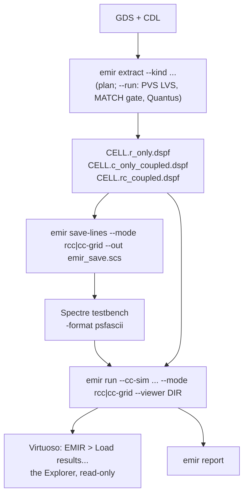

# The Cadence flow

EMIR analyses without any Cadence licence. At a Cadence site the Cadence tools make
its inputs, the DSPF (PVS LVS and Quantus) and the currents (Spectre), and Virtuoso
shows its results on the layout. The integration code is in
[`agent/cadence/`](../agent/cadence/), whose README is the index and gives the status
of every file.

**Screening, not sign-off.**

> **Verified on site, never claimed from elsewhere.** No Cadence tool exists where this
> repository is built and tested, and nothing here claims that Spectre, Virtuoso, PVS,
> Quantus or OCEAN was verified anywhere. Support is proven on the machine that uses
> the tool, by the local agent (with the person's go-ahead for a licensed tool):
> Spectre with `emir verify-sim --sim spectre --run`
> ([Simulators](simulators.md#on-site-verification)); Virtuoso with the headless SKILL
> self-test (`python agent/cadence/python/virtuoso_batch.py --selftest`) and then the
> live test ([`agent/cadence/LIVE_TEST.md`](../agent/cadence/LIVE_TEST.md)); PVS and
> Quantus with `emir extract --run`'s LVS MATCH gate and `emir check` on the DSPF it
> writes. Until its check passes there, each piece is **UNVERIFIED** (OCEAN has no
> check: UNVERIFIED until checked on site). The README of `agent/cadence/` gives the
> status of every file.

For an agent: PVS, Quantus, Spectre and HSPICE are licensed tools, so it asks the person
before running one; `emir extract` runs nothing without `--run`. It never starts,
kills or restarts the person's Virtuoso or simulator: the person loads the EMIR menu
in their own session.

## The pieces

| piece | where | status |
|---|---|---|
| `emir extract`: GDS + CDL to `<cell>.<kind>.dspf` with PVS LVS, a MATCH gate and Quantus; a dry run unless `--run` | `emir/cadence.py` | UNVERIFIED until checked on site by the local agent (the MATCH gate, then `emir check` on the DSPF); tested here with stand-in executables only |
| `emir simulate --sim spectre`: a deck that includes the testbench and the save statements; Spectre runs only with `--run` | `emir/opensim.py` | UNVERIFIED until checked on site by the local agent (`emir verify-sim --sim spectre --run`); tested here with a stand-in executable only |
| `emir save-lines --mode <rcc or cc-grid> --prefix --out`: the Spectre include file for the person's mode | `emir/cli.py` | runs here |
| `emir run --mode cc-grid --self-consistent --sim spectre --run`: the droop loop on the person's split CC netlist (`--split-stub` prints the split) | `emir/selfconsist.py` | UNVERIFIED until checked on site (`emir verify-sim --sim spectre --run` has a self-consistent case for it); tested here with a stand-in executable only |
| the Virtuoso EMIR menu and Screening form | `emir/skillgui.py`, copied to `agent/cadence/skill/emir_main.il` | UNVERIFIED until checked on site by the local agent (the headless self-test, then the live test) |
| the Explorer: results ranked and highlighted on the layout | `emir/skillapp.py`, written next to each run's viewer data | UNVERIFIED until checked on site by the local agent (the live test) |
| the environment-driven entry point | `agent/cadence/skill/emir_init.il` | UNVERIFIED until checked on site by the local agent (live test step 4) |
| Quantus command file, PVS script, Spectre RCC and CC testbenches, OCEAN sketch, Calibre and StarRC notes, batch-Virtuoso helper, site file example | `agent/cadence/` | each file says |
| the on-site checks of Virtuoso | `agent/cadence/python/virtuoso_batch.py --selftest` (headless), `agent/cadence/LIVE_TEST.md` with `agent/cadence/test/emir_manual_test.il` (live) | not run yet: they run on site |

## The flow



### 1. Extraction: `emir extract`

```sh
emir extract --gds blk.gds --cdl blk.cdl --cell blk --kind r_only          # the plan only
emir extract --gds blk.gds --cdl blk.cdl --cell blk --kind r_only --run    # LVS + Quantus
```

Without `--run` it prints the plan and changes nothing: the PVS command line, the LVS
MATCH gate, the Quantus command, the full command file, where each tool and deck was
found, and what is missing with how to fix it (`--format json`: an `emir.extract/1`
document with `ready`, `missing`, `steps`, `settings` and the command file; notice
`EMIR-I680`). With `--run`: PVS LVS (with `-rc_data`, the cross-reference Quantus
reads), then the gate (the LVS report must say `Run Result : MATCH`, or the
extraction is refused with `EMIR-E280`), then Quantus, writing
`<cell>.<kind>.dspf` in the work directory (`emir_out/extract_<cell>`). A matched LVS
newer than the GDS and the CDL is reused, so the R-only and the C-only DSPF of a block
come from one LVS and name instances alike.

Settings come from the option, then the environment (`$PVS_RULES`, `$QRC_TECH_DIR`,
`$QRC_CORNER`, `$EMIR_EXTRACT_TEMP`; tools `$PVS_BIN`, `$QRC_BIN`), then the site file
([`agent/cadence/site/emir_site.cadence.yaml.example`](../agent/cadence/site/emir_site.cadence.yaml.example)),
then `$PATH` for the tools. **No corner and no temperature is ever assumed.**

| kind | what | for |
|---|---|---|
| `r_only` | resistance only | the EM/IR grid `emir run` screens; the grid of the CC flow |
| `c_only_coupled` | devices and coupling C, no R | the netlist simulated for `--mode cc-grid` (big blocks) |
| `rc_coupled` | R and coupling C | the netlist simulated for `--mode rcc` (small blocks) |
| `rc_decoupled`, `c_only_decoupled` | grounded C | decap and dynamic-IR studies |

An `r_only` netlist is **not** an RCC reference: it has no capacitance. Comparing
cc-grid with a simulation of an R-only netlist once gave the wrong sign (measured at the
original development site); against the `rc_coupled` simulation it gave the expected
conservative result.

**The command-file settings that must not be dropped** (a test checks each, for every
kind):

| setting | why |
|---|---|
| `-analysis "em"` | keeps per-segment geometry; otherwise series R is reduced and a merged resistor hides a neck |
| `-include_cap_model "false"`, `-include_res_model "false"`, `-include_parasitic_cap_model "false"` | devices as plain elements |
| `-temperature` | Quantus scales R and writes the \*\|OPERATING_TEMPERATURE record; EMIR reads it and does not scale R again |
| `-sub_node_char ":"` | EMIR puts a node without a \*\|S record on its net by splitting at `:` |
| `-disable_instances false` | keeps the \*\|I instance-pin records that simulated currents attach to |
| `-net_name_space "SCHEMATIC"` | the R-only and C-only extractions name nets alike |
| `-output_xy`, `-include_parasitic_res_width_drawn true` | coordinates for the viewer; the width `J = I / W` needs |
| an absolute LVS-database path | Quantus runs in the work directory |

The command file is UNVERIFIED until checked on site: the local agent verifies it
there by running the extraction (`emir extract --run`, after the person's go-ahead)
and `emir check` on the DSPF it writes. Other extractors: `agent/cadence/calibre/NOTES.md`
and `agent/cadence/starrc/NOTES.md` say what EMIR needs from Calibre and StarRC, with
public sources (UNVERIFIED until checked on site). Whatever made the DSPF, `emir check
<dspf> --process <pdk.yaml>` names every missing annotation
([DSPF requirements](dspf-requirements.md)).

### 2. Currents: Spectre

**Small block, `--mode rcc`** (exact): simulate the RC extraction with every branch
current saved.

```sh
emir save-lines blk.rc_coupled.dspf --mode rcc --prefix XDUT. --out emir_save.scs
spectre tb_rcc.scs -format psfascii -raw tb_rcc.raw =log tb_rcc.log    # agent/cadence/spectre/tb_rcc.scs.tmpl
emir run blk.rc_coupled.dspf --process pdk.yaml --cc-sim tb_rcc.raw --mode rcc --net all \
    --summary-out emir_out/summary.json
```

**Big block (ADC top, PLL top), `--mode cc-grid` with an R-only grid** (see
[Big blocks](big-blocks.md)): simulate the block without parasitic resistance, save
only the instance-pin currents, and push them through the R-only grid.

```sh
emir extract ... --kind r_only --run             # the grid
emir extract ... --kind c_only_coupled --run     # the netlist to simulate (same LVS)
emir save-lines blk.r_only.dspf --mode cc-grid --prefix XDUT. --out emir_save.scs
spectre tb_cc.scs -format psfascii -raw tb_cc.raw =log tb_cc.log      # agent/cadence/spectre/tb_cc.scs.tmpl
emir run blk.r_only.dspf --process pdk.yaml --cc-sim tb_cc.raw --mode cc-grid --net all \
    --summary-out emir_out/summary.json
```

The mode is the person's choice: `emir next` without `--mode` lists rcc, cc-grid and
cc-grid self-consistent with their measured cost and accuracy and recommends one from the
block's size (rcc up to 500 nodes, cc-grid above and for blocks above 50 000 nodes); a pin
at several connections can be screened in rcc only. The Virtuoso form's Mode field starts
at "choose" and will not run until the person picks.

Results must be **text**: `-format psfascii` (or nutascii). Binary PSF is not read: it
is an undocumented format, and guessing at it could produce plausible currents that are
silently wrong; EMIR detects it (EMIR-E408) and gives the command that converts it
(Cadence's `psf` utility: `psf -i tran.tran -o tran.psfascii`). `emir simulate
<tb.scs> --sim spectre --dspf <dspf> --prefix XDUT. --mode rcc` writes the deck (your
testbench, then the save statements) and prints the Spectre command; with `--run` it
runs it, after the person's go-ahead. Before the first run that uses Spectre on a
machine, `emir verify-sim --sim spectre --run` proves the route there; APS and Spectre X
take `--sim-args` ([Simulators](simulators.md#spectre)). From ADE: add `emir_save.scs`
under the test's definition files, write the results as psfascii, then **EMIR >
Screening...** with the result directory. `agent/cadence/ocean/emir_run.ocn.tmpl` is an
UNVERIFIED OCEAN sketch of the same.

`emir run blk.r_only.dspf --net VDD --mode cc-grid --self-consistent --netlist tb_cc.scs
--vdd V --run` drives Spectre itself to close the droop loop ([Methods and
modes](method-modes.md#closing-the-loop-self-consistency)): Spectre runs once per pass, so
ask first; without `--run` it writes pass 0's droop files (0 V) and prints the command.
EMIR does not read a Spectre netlist: the per-pin split (a `vsource type=pwl file=` per
pin, reading the droop waveform EMIR rewrites every pass; UNVERIFIED until checked on
site) goes into the CC netlist once, by hand (`emir
run blk.r_only.dspf --net VDD --split-stub` prints it; `spectre/tb_cc.scs.tmpl` says
where); the run refuses a netlist without it (`EMIR-E524`) and writes only in
`emir_out/selfconsist/<net>/`.

### 3. Results on the layout: Virtuoso

**Load the EMIR menu**, from a clone or the offline bundle:

```sh
export EMIR_HOME=/path/to/emir          # the clone or the unpacked bundle
export EMIR_PROCESS=/path/to/pdk.yaml   # optional: the default process file
export EMIR_LIB=MYLIB                   # optional: the default OA library
```

and one line in `~/.cdsinit`:

```text
load(strcat(getShellEnvVar("EMIR_HOME") "/agent/cadence/skill/emir_init.il"))
```

`EMIR_BIN` (default `$EMIR_HOME/bin/emir`), `EMIR_WORK` (`emir_out`), `EMIR_VIEW`
(`layout`) and `EMIR_UNSET_LD=1` (start emir without Virtuoso's `LD_LIBRARY_PATH`)
are optional too; an empty value counts as unset. `emirSettings()` in the CIW prints
what was taken.

From any install (pip included), `emir gui-install` writes `emir_main.il`,
`emir_explorer.il`, `emir_display.drf` and `emir_site.il` into `<clone>/skill/` or
`~/.emir/skill/` (or `--dir D`); `emir_site.il` is the only file that holds this
machine's paths, and `.cdsinit` loads it.

**Colours**: append `emir_display.drf` to `~/display.drf` and restart Virtuoso. Never
put it in place of a project or PDK `display.drf`: that removes every layer's colours.
Without the packets the Explorer draws every band in one colour and says so in the CIW.

**The menu**: EMIR > **Screening...** (the form: check inputs, run, save lines, open the
HTML, load the viewer), **Spectre save lines...**, **Load results...**, **Site info**,
**Cadence integration notes**. The form runs `emir <command> @<argument file>` as a
child process with Virtuoso's Python environment removed (`env -u PYTHONHOME -u
PYTHONPATH`), every path shell-quoted, and streams its log into the form; save lines go
to `<output>/emir_save.scs`. It is registered once per session, on schematic and layout
windows.

**The Explorer**: `emir run ... --viewer DIR --lib LIB` writes `emir_data.il` and
`emir_explorer.il`; **EMIR > Load results...** opens the layout **read-only** and lists
the segments at or above 80 % of their limit, worst first, each with its fix; EM or IR;
next and previous; zoom to the selection. It only draws highlight sets: the cellview is
never changed, and closing the form removes its highlights. Coordinates are those of
the extracted cell, so a block's results open on the block's layout. A band is a step
0 to 11 of EMIR's colour scale, the one every chart and HTML page draws (0 to 9 the blue
ramp, 10 the warn amber, 11 the failure red), drawn with the display packet
`EMIR_B<step>`. The list holds at most 2 000 rows.

On the bundled sample the Explorer lists 16 EM segments, 10 of them at or above 80 %
(avg), and 16 IR segments on VDD, with the fixes "Metal1: widen 0.750 -> 1.255 um
(x1.67)" and "Cont: 1 -> 2 cuts (+1)" (`tests/test_cadence_viewer.py`): what the live
test expects to see.

**Viewer data on big runs**: above 20 000 segments the clean ones (below 0.5x) are left
out and the worst 20 000 kept; IR keeps the rails' segments, largest drop first, up to
20 000; `EMIR-I780` says what was left out, and `--viewer-all` writes everything. On a
synthetic 50 000-resistor net (every segment below 0.5x), `emir_data.il` was 1 190 721
bytes trimmed against 10 977 518 bytes with `--viewer-all`, and the whole run 4.6 s
against 8.9 s on the development machine
(`pytest -s tests/test_cadence_viewer.py -k 50k`).

The same `--viewer` directory also holds a KLayout marker database (`emir.lyrdb`), for
looking at the results without Virtuoso ([Open-source flow](open-source-flow.md#looking-at-the-results-in-klayout)).

## Try it offline

[`examples/09_cadence_flow`](../examples/09_cadence_flow/) runs what a Cadence site does,
without any Cadence tool: the extraction plan with nothing configured (`ready` false,
`missing` naming the rule deck, the Quantus technology directory, the corner and the
temperature), the plans for `r_only` and `c_only_coupled` from one site file, the
Spectre save lines for the sample, and the RCC testbench filled in.

```sh
bash examples/09_cadence_flow/run.sh
```

## Measured at the original development site

Measurement provenance, not support: internal measurements made while EMIR was
developed, on an extracted OTA; quoted as the source of the numbers below, not
reproducible from this repository. They are numbers
about the method and its cost, not evidence that any Cadence tool works with EMIR: every
Cadence route stays UNVERIFIED until its on-site check (above) passes on the machine that
runs the tools.

- GDS + CDL to DSPF in 12.7 s: PVS LVS 2.4 s, Quantus 10.3 s. Per kind from one LVS:
  `c_only_coupled` 2.7 s, `r_only` 10.5 s (288 R, 249 nodes: the single-cut-via
  variant of the OTA), `rc_coupled` 11.1 s.
- CC simulation 0.81 s against RCC 1.00 s at 249 nodes: on a block this small, use rcc.
- A batch Virtuoso launch: about 25 s to about 3 minutes of wall time.

On a generated test block (inverters on a segmented rail), also measured at the original
development site, RCC against CC + grid: 1.92 s / 1.97 s at 41 rail nodes, 3.83 s /
2.19 s at 521, 9.53 s / 2.61 s at 2 057.

Not measured: the often-quoted 10 to 100 times slowdown of an RCC transient on a big
block is literature and experience, not a measurement of this project.

## UNVERIFIED until checked on site, in one list

Everything Cadence, until its on-site check passes on the machine that uses it:

- Everything that needs a live Virtuoso: the EMIR menu (registration, the schematic
  view type, Layout XL windows), the Screening form and its child-process handling,
  `emir_init.il`, the site stub, the Explorer (highlight, list, zoom, timer, colour
  packets and the one-colour fallback, window matching, clean-up on close), the
  2 000-row cap, and whether `drLoadDrf` can merge the packets at run time. The checks:
  the headless self-test, then `agent/cadence/LIVE_TEST.md`; neither has run.
- `emir extract --run` and `pvs_lvs_quantus.sh` against real PVS and Quantus (the
  command lines, the command file, the settings, LVS reuse, the report and its regular
  expression, finding the DSPF): tested here only with stand-in executables.
- Spectre: the save statements, `emir simulate --sim spectre`'s deck, the testbench
  templates (`emir verify-sim --sim spectre --run` checks the route); the OCEAN sketch
  (no check).
- Calibre and StarRC: every option in the notes and sketches (`emir check` on the DSPF
  they write).

Cadence, Virtuoso, Spectre, Quantus, PVS and OCEAN are trademarks of Cadence Design
Systems, Inc. EMIR is not affiliated with or endorsed by Cadence.
