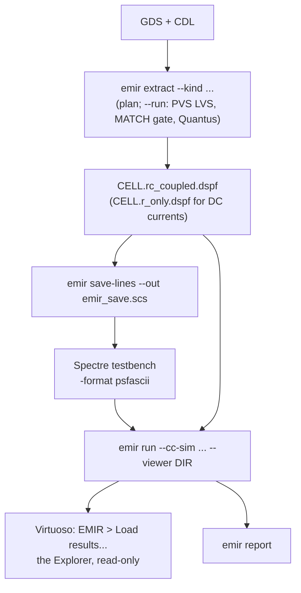

# Cadence

EMIR analyses without any Cadence licence. At a Cadence site the Cadence tools make its
inputs, the DSPF (PVS LVS and Quantus) and the currents (Spectre), and Virtuoso shows its
results on the layout. The integration code is in [`agent/cadence/`](../agent/cadence/),
whose README gives the status of every file.

**Screening, not sign-off.**

> **Verified on site, never claimed from elsewhere.** No Cadence tool exists where this
> repository is built and tested, and nothing here claims that Spectre, Virtuoso, PVS,
> Quantus or OCEAN was verified anywhere. Each is proven on the machine that uses it, by
> the local agent with the person's go-ahead: Spectre with
> `emir verify-sim --sim spectre --run` ([Simulators](simulators.md#on-site-verification));
> Virtuoso with the headless SKILL self-test
> (`python agent/cadence/python/virtuoso_batch.py --selftest`) and then the live test
> ([`agent/cadence/LIVE_TEST.md`](../agent/cadence/LIVE_TEST.md)); PVS and Quantus with
> `emir extract --run`'s LVS MATCH gate and `emir check` on the DSPF it writes. Until
> then each piece is **UNVERIFIED**.

An agent asks the person before running PVS, Quantus, Spectre or HSPICE; `emir extract`
and `emir simulate` run nothing licensed without `--run`. It never starts, kills or
restarts the person's Virtuoso: the person loads the EMIR menu in their own session.



## 1. Extraction: `emir extract`

```sh
emir extract --gds blk.gds --cdl blk.cdl --cell blk --kind rc_coupled          # the plan only
emir extract --gds blk.gds --cdl blk.cdl --cell blk --kind rc_coupled --run    # LVS + Quantus
```

Without `--run` it prints the plan and changes nothing: the PVS and Quantus commands, the
command file, where each tool and deck was found, and what is missing. With `--run`: PVS
LVS, the gate (the report must say MATCH, else `EMIR-E280`), then Quantus, writing
`<cell>.<kind>.dspf`. A matched LVS is reused, so two kinds of DSPF of a block name
instances alike. Settings come from the options, the environment (`$PVS_RULES`,
`$QRC_TECH_DIR`, `$QRC_CORNER`, `$EMIR_EXTRACT_TEMP`), then the site file
([`emir_site.cadence.yaml.example`](../agent/cadence/site/emir_site.cadence.yaml.example)).
**No corner and no temperature is ever assumed.**

| kind | what | for |
|---|---|---|
| `r_only` | resistance only | the grid `emir run` screens with DC currents (`--currents`) |
| `rc_coupled` | R and coupling C | the netlist simulated for rcc, and the DSPF it screens |
| `rc_decoupled` | R and grounded C | the same with grounded capacitance |

The command file keeps what EM needs, and a test checks each setting: `-analysis "em"`
(per-segment geometry, no series reduction), `-temperature` (Quantus scales R and states
it), `-sub_node_char ":"`, `-disable_instances false` (the `*|I` records),
`-net_name_space "SCHEMATIC"`, `-output_xy`, `-include_parasitic_res_width_drawn true`,
and the device models off. It is UNVERIFIED until the extraction runs on site and
`emir check` passes on its DSPF. Calibre and StarRC: `agent/cadence/calibre/NOTES.md` and
`agent/cadence/starrc/NOTES.md` (UNVERIFIED).

## 2. Currents: Spectre

```sh
emir save-lines blk.rc_coupled.dspf --prefix XDUT. --out emir_save.scs
spectre tb_rcc.scs -format psfascii -raw tb_rcc.raw =log tb_rcc.log    # agent/cadence/spectre/tb_rcc.scs.tmpl
emir run blk.rc_coupled.dspf --process pdk.yaml --cc-sim tb_rcc.raw --net all \
    --period 10n --summary-out emir_out/summary.json
```

The testbench simulates the RC extraction, and the save lines keep every resistor's
current: the rcc run of [Method and accuracy](method.md), over the record's last whole
periods of the block's `--period` (here 10 ns).
UNVERIFIED until checked where Spectre runs.

Results must be **text** (`-format psfascii`); binary PSF is refused (`EMIR-E408`) with
the `psf` command that converts it.
`emir simulate <tb.scs> --sim spectre --dspf <dspf> --prefix XDUT.` writes the
deck and prints the command; `--run` runs it, after the person's go-ahead. From ADE: add `emir_save.scs` to the test's definition files,
write psfascii results, then **EMIR > Screening...**. `agent/cadence/ocean/` has an
UNVERIFIED OCEAN sketch.

## 3. Results on the layout: Virtuoso

```sh
export EMIR_HOME=/path/to/emir          # the clone or the unpacked bundle
export EMIR_PROCESS=/path/to/pdk.yaml   # optional: the default process file
```

and one line in `~/.cdsinit`:

```text
load(strcat(getShellEnvVar("EMIR_HOME") "/agent/cadence/skill/emir_init.il"))
```

From any install, `emir gui-install` writes the SKILL files into `~/.emir/skill/` (or
`--dir D`). Append `emir_display.drf` to `~/display.drf` for the colours (never in place
of a PDK's). The **EMIR** menu has the Screening form (check inputs, run, save lines,
open the HTML, load the viewer; its **Period** field is `--period`), Spectre save lines
and **Load results...**.

`emir run ... --viewer DIR --lib LIB` writes the Explorer's data; **Load results...**
opens the layout **read-only**, lists the segments at or above 80 % of their limit,
worst first, each with its fix, and zooms to the selection. It only draws highlight
sets: the cellview is never changed. On the bundled sample it lists the fixes "Metal1:
widen 0.750 -> 1.255 um (x1.67)" and "Cont: 1 -> 2 cuts (+1)" (`tests/test_cadence_viewer.py`):
what the live test expects to see. Above 20 000 segments the clean ones are left out
(`EMIR-I780`; `--viewer-all` keeps all). The same directory holds a KLayout marker
database ([Simulators](simulators.md#looking-at-the-results-in-klayout)).

## Try it offline

[`examples/09_cadence_flow`](../examples/09_cadence_flow/) runs what a Cadence site does,
without any Cadence tool: the extraction plan with nothing configured, the plans from a
site file, the Spectre save lines and the RCC testbench filled in.

```sh
bash examples/09_cadence_flow/run.sh
```

## Measured at the original development site

Measurement provenance, not support: internal measurements made while EMIR was
developed, on an extracted OTA, not reproducible from this repository. They are about the
method and its cost, not evidence that any Cadence tool works with EMIR.

- GDS + CDL to DSPF in 12.7 s (PVS LVS 2.4 s, Quantus 10.3 s); `r_only` 10.5 s,
  `rc_coupled` 11.1 s.
- RCC simulation 1.00 s at 249 nodes.
- On a generated test block (inverters on a segmented rail), RCC: 1.92 s at 41 rail
  nodes, 9.53 s at 2 057.

UNVERIFIED until checked on site: everything that needs a live Virtuoso (the menu, the
form, `emir_init.il`, the Explorer and its colours), `emir extract --run` against real
PVS and Quantus, Spectre's save statements and decks, the OCEAN sketch, and the Calibre
and StarRC notes.

Cadence, Virtuoso, Spectre, Quantus, PVS and OCEAN are trademarks of Cadence Design
Systems, Inc. EMIR is not affiliated with or endorsed by Cadence.
