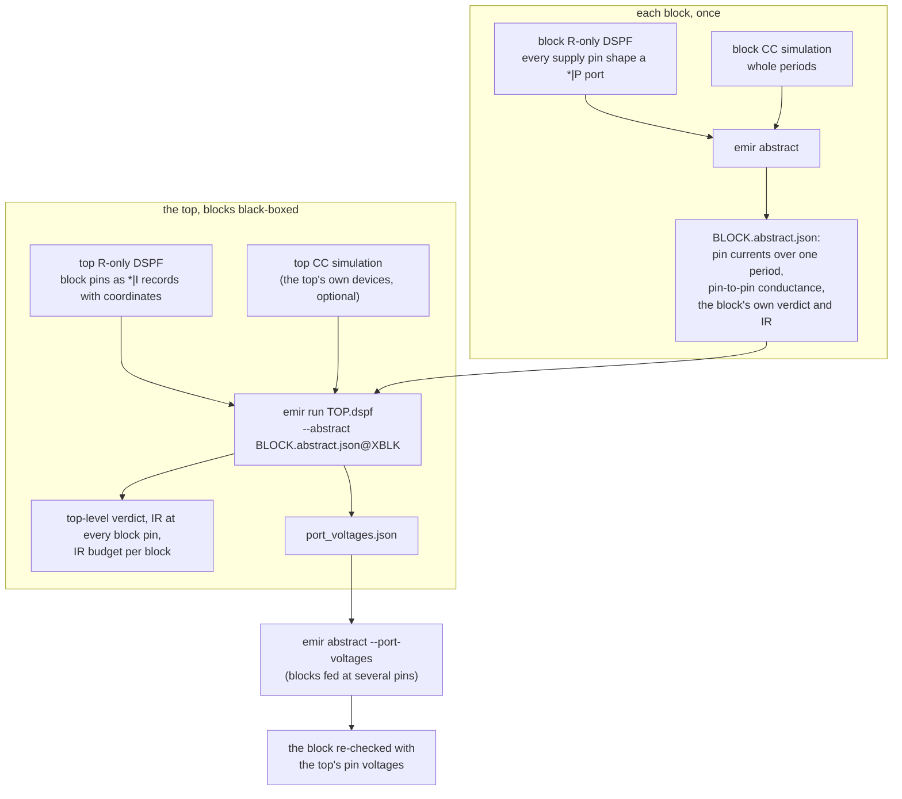
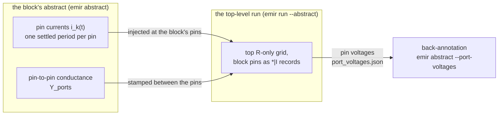
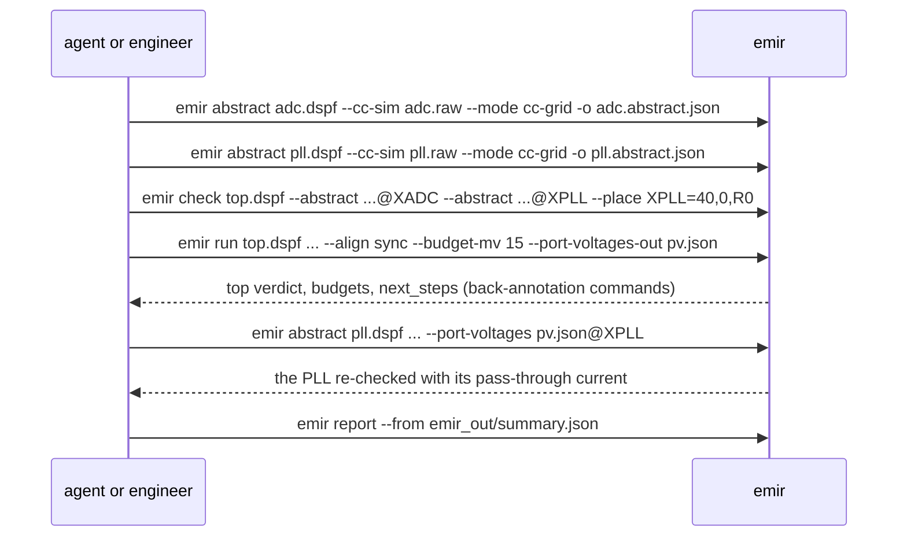

# Chip-level EM/IR, hierarchically

A chip, or a top built from several big blocks, is too big to screen as one net: its
simulation (even C-only) and its extraction grow with every block in it, and an RCC
transient of it converges poorly and slowly. The hierarchical flow splits the work
along the design's own hierarchy and passes only **pins and currents** between the
levels: each block is characterised once, from its own simulation and extraction, and
the top is screened with the blocks black-boxed. One ADC or PLL top that you extract
and simulate as a single DSPF belongs on [Big blocks](big-blocks.md) instead.

**Screening, not sign-off.**

## The idea



1. **Each block, once** (`emir abstract`): the block's R-only DSPF and its CC
   simulation give its own EM/IR verdict, and an *abstract*: what each supply pin
   draws over one period, and the conductance between its pins.
2. **The top, with the blocks black-boxed** (`emir run TOP.dspf --abstract
   FILE@INST ...`): the blocks' pins are instance pins of the top DSPF; each
   abstract's pin currents are injected there, its pin-to-pin conductance is stamped
   between them, and the top-level grid is screened like any other net.
3. **Budgets and back-annotation**: the IR budget per block is the top-level drop at
   its worst pin plus its internal drop (`--budget-mv`); a block fed at several pins
   is re-checked with the top's pin voltages (`--port-voltages-out`, then
   `emir abstract --port-voltages`), because it carries pass-through current the
   block-alone run cannot see.
4. **Recursion**: a mid-level block is abstracted from its own devices and its
   sub-blocks' abstracts (`emir abstract MID.dspf --cc-sim MID.raw --mode cc-grid
   --abstract SUB.abstract.json@XSUB`), and the top's own devices outside the blocks come from
   the top's CC simulation (`emir run ... --abstract ... --cc-sim TOP.raw`).

The grid is linear, so superposition makes the split exact, given the period each
abstract stores (one period, resampled to 4 096 points by default; `EMIR-W803` when that
loses detail): on the synthetic chip of `examples/05_chip_level`, every top-level branch
(avg, rms and peak) equals a flat run of the same network to a relative 4.9e-13.

## What crosses the boundary



An abstract carries, per supply net of the block:

| field | what |
|---|---|
| pin currents | the current each pin pushes **into the top-level net** (a load is negative): exact avg, rms and peak over the simulation window, plus the last settled period on a uniform grid (`--points`, default 4096) with its phase reference `t_ref_s` |
| `y_ports` | the exact Norton conductance of the block grid between its pins, `G_PP - G_PI G_II^-1 G_IP` (a Schur complement); stamped between the pins at the top |
| `internal` | the block's own verdict and IR drop with every pin held at one ideal potential |
| decap lump | `C = sum c`, `R = c^T G^-1 c / C^2` (two moments of the admittance at the pins); recorded, not used by `emir run` |
| internal dynamic droop | when the block DSPF carries capacitance |

## The procedure, end to end

| step | what | command |
|---|---|---|
| 0 | prove the install | `emir selftest` |
| 1 | per block: extract R-only at the EM temperature, every supply pin shape a \*\|P port with coordinates | your extractor (see [What the extractions must contain](#what-the-extractions-must-contain)) |
| 2 | per block: CC-simulate over whole periods of its activity, the instance-pin currents saved, ASCII | `emir save-lines BLOCK.dspf --mode cc-grid`, then the simulator |
| 3 | per block: the abstract and the block-level verdict | `emir abstract BLOCK.dspf --process P --cc-sim BLOCK.raw --mode cc-grid --period T -o BLOCK.abstract.json` |
| 4 | the top: extract R-only with the blocks black-boxed, their pins as \*\|I records with coordinates, one per physical connection | your extractor; check with `emir pins TOP.dspf --net VDD` |
| 5 | plan and check the top run | `emir next --dspf TOP.dspf --process P --abstract ...`; `emir check TOP.dspf --process P --abstract ... --place ...` |
| 6 | the top-level run, budgets, pin voltages | `emir run TOP.dspf --process P --abstract A.abstract.json@XA --abstract B.abstract.json@XB --place XB=DX,DY,ORIENT --align sync --budget-mv 15 --port-voltages-out emir_out/port_voltages.json --summary-out emir_out/summary.json` |
| 7 | relay the result | `emir report --from emir_out/summary.json` |
| 8 | back-annotate every block fed at several pins | the `emir abstract ... --port-voltages emir_out/port_voltages.json@XB -o ...` command in the run's `next_steps` |
| 9 | when a pin droops by more than about 2 % (`EMIR-W805`): re-simulate the block at `v_delivered_V`, re-abstract, re-run; repeat until the pin voltages settle | steps 2, 3, 6 |
| 10 | for a mid-level block: steps 1 to 3 with its sub-blocks black-boxed and `--abstract SUB.abstract.json@XSUB` | `emir abstract MID.dspf ... --abstract SUB.abstract.json@XSUB --place XSUB=...` |

There are two verdicts per level: the **top-level grid** (step 6) and each **block's
own EM** (step 3, re-checked in step 8 when the block is fed at several pins). Relay
both.



## Commands

### `emir abstract`

`--mode cc-grid` is required, and the only mode an abstract takes (EMIR-E521 for rcc):
the person's choice of the hierarchical route is a choice of cc-grid, since an abstract is
the block's pin currents superposed through its own grid. The top-level run with
`--abstract` is cc-grid by construction and needs no `--mode`.

```text
emir abstract BLOCK.dspf --process P --cc-sim RESULT --mode cc-grid -o X.abstract.json
              [--net A,B] [--period S] [--points N] [--analysis A]
              [--vdd V | --vdd NET=V ...] [--em-temp C] [--delta-t C]
              [--port-voltages F@INST]
              [--abstract SUB.abstract.json@XSUB ... [--place XSUB=DX,DY,ORIENT]
               [--place-tol UM] [--phase XSUB=S]]
              [--top TOP.dspf@INST]
              [--fail-on-violation] [--no-check] [--force] [--format text|json]
```

- `--net`: the block nets to abstract (default: every net with a `*|P` port and
  instance pins).
- `--period`: the block's period (auto-detected if omitted). The window is the
  longest settled whole-period tail of the simulation; the **last** period is stored.
- `--vdd`: the nominal supply, for the droop warning of the top run (`EMIR-W805`).
- `--port-voltages F@INST`: back-annotation (below).
- `--abstract`, `--place`, `--phase`: the block's own sub-blocks (recursion).
- `--top TOP.dspf@INST`: the top this block is placed in, as instance INST: the
  summary's next step is then `emir next` on the top with this abstract, the way back
  to the chip-level plan.
- Output: the abstract file `emir.abstract/1` (with the waveforms); with
  `--format json`, stdout carries `emir.abstract_summary/1` (the same without the
  waveforms, plus `out`, `use`, `notices`, `next_steps`).
- Exit status: 0; 1 with `--fail-on-violation` when the block's verdict is FAIL; 2 on
  a refusal; 3 when a required package is missing.

### `emir run` with blocks black-boxed

```text
emir run TOP.dspf --process P --abstract FILE@INST [...]
         [--place INST=DX,DY[,ORIENT] ...] [--place-tol UM]
         [--align inphase|sync|async] [--phase INST=S ...] [--phase-sweep INST:N ...]
         [--budget-mv MV] [--port-voltages-out F]
         [--cc-sim TOP.raw [--period S] [--analysis A]]   (the top's own devices)
         [--net N] [--feed NODE] [--summary-out F] [--html D] [--viewer D] ...
```

- `--net`: default every top net on which an abstract covers a pin.
- `--place`: the block's origin in the top frame (um) and its orientation (R0, R90,
  R180, R270, MX, MY, MXR90, MYR90); needed when a block pin reaches the top at
  several records.
- `--feed`: the node the net is fed at; without it the `*|P` ports of the net are the
  pads, held at one ideal potential when there are several (`EMIR-I801`).
- The run summary (`emir.run/1`) gains `hierarchy`: the blocks and their verdicts,
  every block pin's voltage and current, the pass-through inside blocks fed at
  several pins, the budget rows, the port-voltages file, notes.
  `current_source.kind` is `abstracts`.
- Not combined with `--abstract` (`EMIR-E811`): `--currents`, `--netlist`,
  `--self-consistent`, `--ground`, `--taps-out`, `--mode rcc`, `--dynamic`, and
  `--scalars` with another `--align` than inphase.
- `--fail-on-violation` exits 1 on an EM FAIL **or** a budget FAIL.

`emir check` takes the same options and checks the abstracts, where their ports land,
the placement and the sync grid before anything runs. `emir next` takes `--abstract`,
`--place`, `--align` (and `--cc-sim` for the top's devices) and plans check, run,
report and the back-annotation steps; with a black-boxed block and no abstracts it
advises the route. An `--abstract` file that does not exist yet gets its `emir
abstract` step (waiting on the block's DSPF and result), then `emir next` again: nothing
past the abstracts is planned until every one can be read. A top above the big-block
size is flagged as a long run (`needs_human`), as its flat run would be. `--dynamic`, and
an `--em-basis` that needs it, are in `missing[]` (EMIR-E811), not in a planned command.
After the run, `emir next --run-summary` reads its `--abstract`, `--place` and `--align`
back from the summary and plans the back-annotation from the port voltages it wrote.

## Method

### Matching block pins to the top

One port and one record of a block pin: matched by name. Several: by coordinates,
each port moved into the top frame by `--place` and matched to the one record within
`--place-tol` (default 1 um). Anything else is refused: one record for several ports
or several records for one port (`EMIR-E807`), no placement (`E806`), no record or
two records in reach, or a record taken twice (`E808`). A symmetric block mirrors onto
the same coordinates, so placement is never guessed.

### Aligning the blocks in time

| `--align` | rms and peak on a top-level branch | when |
|---|---|---|
| `inphase` (default) | the sum over k of abs(T_ek) I_k: the upper bound over every alignment; avg exact | always safe |
| `sync` | exact for one clock reference: each stored period on a common grid (the least common multiple of the periods), shifted by its `t_ref` plus `--phase` | blocks on related clocks with known phase; all block simulations assumed to start on the same clock edge (`t = 0`) |
| `sync --phase-sweep INST:N` | the worst over N phases of INST's period, per branch | related clocks of unknown phase |
| `async` | avg exact; rms^2 = avg^2 + the sum of the blocks' variances (exact in the long-time limit); peak = the worst over every relative phase | **unrelated clocks only**: not an upper bound for related clocks (`EMIR-W802`) |

In `sync`, the periods must be whole numbers of the common step and the common
period at most 2^21 samples (`EMIR-E810`). On the example, a sync phase reaches rms
4.5491 mA on the trunk where async gives 4.1826 mA: async under-reads related clocks.

The top's own devices outside the blocks (`--cc-sim TOP.raw`) are read from the top's
CC simulation, each on a uniform period, and join the blocks in every alignment mode
(in async as one group).

### IR budget

Per block net: the top-level drop at its worst pin plus its internal drop (pins held
at one potential) must stay within `--budget-mv`. For a one-pin supply this is exactly
the block's worst droop from the pad. For several pins it is an upper bound: by the
maximum principle, the top-induced shift of an internal node is a weighted mean of
its pins' voltages, so it never exceeds the worst pin's. Each budget row says whether
it is exact. The row also reports the top-level peak droop at the pin and the block's
internal dynamic droop when there is one; the verdict is on the static sum.

### Back-annotation

A block fed at several pins carries current from one pin to another through its own
grid (the pass-through), which a block-alone run, pins held at one potential, cannot
see. The block's branch currents are the sum of two solutions of its own grid: the
devices with the pins at one potential (the abstract), and the pin voltages with no
devices (the pass-through). From a sync run without a phase sweep the pin waveforms
are in the port-voltages file and the result is exact. From inphase, async or a
sweep, avg is exact and rms and peak are upper bounds. The back-annotated IR drop is
measured from the top's reference (the pad): the flat-equivalent number.

On the example the PLL's first segment carries 1.3333 mA with its pins shorted (0.952x,
WARN) and 1.4074 mA back-annotated (1.005x, FAIL): the block-alone verdict reads
5.26 % low. Back-annotate every block fed at several pins.

### Top-level self-consistency (a documented loop)

The blocks' currents were simulated at the nominal supply. When the droop at a pin is
large (`EMIR-W805`: above 2 % of `--vdd`), re-simulate the block with its supply at
`v_delivered_V` from the port-voltages file (the least-drooped pin's voltage: the
currents stay conservative), re-abstract, re-run the top, and repeat until the pin
voltages settle. The first pass (pass 0, the nominal supply) over-reads the current,
the conservative direction; the passes after it alternate around the fixed point, so
an intermediate pass can **under-read**: on the example, with an ohmic stand-in for the
block, pass 0 read 20.000 mA (+3.00 %), pass 1 19.400 mA (-0.09 %, below the converged
19.4175 mA), and six passes converged to 7.3e-10 of the closed form. Report only the
settled value, or pass 0 as the conservative screen; the converged value is not a
bound.

### Recursion

`emir abstract MID.dspf --cc-sim MID.raw --mode cc-grid --abstract SUB.abstract.json@XSUB` puts the
mid-level block's devices and its sub-blocks on one common clock reference (`--phase`
shifts a sub-block), stamps the sub-blocks' port conductances into the mid-level grid,
and writes the mid-level abstract: its pin currents include the sub-blocks', and its
`y_ports` composes theirs. The mid-level abstract is used at the top like any other.
A two-level chip in the tests (a top, a mid-level block with its own device, a PLL
inside it fed from two sides) matches the three-level flat run within a relative 1e-9
on every top branch and every back-annotated mid-level branch.

## What the extractions must contain

- **Block DSPF:** R-only (or RC) at the EM analysis temperature, with segment geometry
  (`$W`, `$L`) and via cut counts; every supply pin shape a `*|P` port with
  coordinates; `*|I` records of the device pins. `emir nets BLOCK.dspf` marks the nets
  with a port.
- **Top DSPF:** the blocks black-boxed, their pins emitted as `*|I` records with
  coordinates, **one per physical connection**; the top-level metal over the blocks
  still extracted; the same temperature as the blocks. Confirm with
  `emir pins TOP.dspf --net VDD` that every block pin appears, with its coordinates.
- A top record's pin name must equal the block net name, and its instance the `INST`
  of `--abstract FILE@INST`.
- **UNVERIFIED:** how each extractor black-boxes a cell and names a second connection
  to the same pin (for example a skip-cells list in StarRC, an LVS box with Calibre
  xRC/xACT, a black-box option of Quantus, an abstract view with magic or KLayout) has
  not been checked against public documentation or run here. The flow therefore
  matches multi-connection pins by coordinates, never by the extractor's naming.

## The worked example

[`examples/05_chip_level`](../examples/05_chip_level/) is a synthetic chip with two
blocks, made offline from closed-form waveforms (no simulator, no PDK):

```text
pad VDD (-50,0) -Rt0 0.5- T1 (0,0) -Rt1 1.0- XADC:VDDA (0,40)            block adc, 1 pin
                           |  \-Rt2 1.0- XPLL:VDDP (40,0)               block pll, west pin
                           \-Rt3 0.5- T2 -Rt4 1.75- T3 -Rt5 0.5- XPLL:VDDP#2 (70,0)
                                                                        block pll, east pin
```

```sh
bash examples/05_chip_level/run.sh          # about 6 s; compares 93 values with expected/
```

It runs the abstracts, the check, the top run, the report, the back-annotation, a
burst variant for the alignment modes, and the flat reference; `measure.py` checks the
results against hand calculation and the flat run, and `compare.py` against the golden
files (relative tolerance 1e-6).

| what | number |
|---|---|
| every top-level branch x avg/rms/peak, hierarchical (sync) vs flat | max relative difference 4.9e-13 |
| every block branch, back-annotated vs flat | 6.6e-13 (ADC), 4.4e-15 (PLL) |
| pin voltages (ADC; PLL west, east) | -4.0000; -3.4074, -3.6296 mV (hand: -4, -92/27, -98/27 mV) |
| pass-through inside the PLL | 0.07407 mA (hand: 2/27 mA) |
| ADC budget (one pin) | 4.0000 + 7.5000 = 11.5000 mV, equal to the flat 11.5000 mV |
| PLL budget (two pins) | 3.6296 + 11.3333 = 14.9630 mV, bounding the flat 14.8148 mV |
| PLL first segment, pins shorted vs back-annotated | 1.3333 vs 1.4074 mA: 0.952x WARN vs 1.005x FAIL |
| alignment, trunk Rt0, ADC in bursts (8 mA, 1 ns per 10 ns) with the PLL | inphase rms 5.3384 mA; async 4.1826 mA (hand 4.1826); sync over 20 PLL phases rms 3.7808 to 4.5491 mA, peak 8 to 12 mA |
| self-consistency loop (ohmic stand-in, closed form 19.4175 mA) | pass 0 over-reads by 3.00 %; 6 passes; converged to 7.3e-10 of the closed form |
| the whole example | 5.9 to 6.1 s wall over three runs on the development machine (24 hardware threads) |

From `tests/test_hierarchy.py`: the Schur conductance of a 3 x 3 mesh with three ports
matches dense elimination within a relative 1e-12, and the decap lump of 1 pF at 2 ohm
and 1 pF at 4 ohm from the pin (2 ohm shared) is the closed form, C = 2 pF and
R = 2.5 ohm.


*Chip-level EM/IR, hierarchically (examples/05_chip_level, synthetic).*

## Limits

- Screening, not sign-off.
- The grid is linear and the device currents come from a CC simulation at the nominal
  supply: the decoupling of the cc-grid route ([Big blocks](big-blocks.md)); within a
  block, the self-consistent loop (`--self-consistent`) corrects it, each pin fed its
  droop waveform.
- An abstract stores the last settled period; the scalars are over the whole window,
  whose periods may differ by up to the window's settle tolerance (2 %). An aperiodic
  abstract is repeated as if periodic in sync (`EMIR-W801`).
- At the top, async alignment and a phase sweep hold a branches x taps matrix of their
  own (the taps are the block pins plus the top's devices): above 2 GiB the run
  refuses with `EMIR-E418` and a runnable `--align inphase` step. The same budget
  applies inside `emir abstract`: a block too big for it must be split further.
- A harmonic (PSS frequency-domain) result cannot be abstracted (`EMIR-E805`): use the
  time-domain output.
- Back-annotation reaches one level down: a sub-block inside a mid-level block is
  re-checked against its parent held at one potential (run the parent as a top:
  `emir run MID.dspf --abstract SUB@XSUB --cc-sim MID.raw --port-voltages-out F`); the
  chip-level pass-through is not propagated two levels down.
- The decap lump is recorded, but `emir run` does not use it: the top-level pin
  voltages are resistive.
- Not measured: performance on large tops and blocks (only the synthetic example and
  tests ran); how much peak the default 4096-point resample keeps on a real
  variable-step simulation (`EMIR-W803` reports it at run time); the
  self-consistency loop with a real re-simulated block (the example uses an ohmic
  stand-in).

## Error codes

| code | when | what to do |
|---|---|---|
| `EMIR-E801` | an `--abstract` file is not a usable `emir.abstract/1` | rewrite it with `emir abstract`; `emir schema abstract` |
| `EMIR-E802` | an INST of `--abstract`, `--place`, `--phase`, `--phase-sweep` has no record in the DSPF | use the instance name of the \*\|I records (`emir pins`) |
| `EMIR-E803` | a block net has no \*\|P port | re-extract with every pin shape a port |
| `EMIR-E804` | no block net has a port and instance pins | give `--net` |
| `EMIR-E805` | a harmonic (PSS fd) result | use the time-domain output |
| `EMIR-E806` | several records, several ports, no `--place` | read the placement from `emir pins` or the layout |
| `EMIR-E807` | port count and record count differ | re-extract (the hint says which side) |
| `EMIR-E808` | a placed port finds no record, two, or a taken one | fix `--place`, or `--place-tol` |
| `EMIR-E809` | no abstract lands on the net | check the instance names and `--net` |
| `EMIR-E810` | sync cannot build the common grid | `--align inphase`, or async for unrelated clocks |
| `EMIR-E811` | an option not combined with `--abstract` | drop it |
| `EMIR-E812` | the port-voltages file does not fit (instance, net, ports, another result) | re-run the top with this abstract and `--port-voltages-out` |
| `EMIR-E813` | the top net has no \*\|P port | `--feed NODE` |
| `EMIR-W801` | an aperiodic abstract repeated in sync | characterise with `--period` |
| `EMIR-W802` | async alignment | only for unrelated clocks |
| `EMIR-W803` | resampling kept less than 99 % of a peak | raise `--points` |
| `EMIR-W804` | a multi-pin block verdict with its pins shorted | back-annotate |
| `EMIR-W805` | droop at a block pin above 2 % of its supply | the self-consistency loop |
| `EMIR-W806` | a block pin with no current | abstract every supply net; check pin names |
| `EMIR-W807` | top-level instance pins with no current | `--cc-sim` with the top's simulation, or abstract them |
| `EMIR-W808` | an abstract at another temperature | re-abstract with the run's process file and `--em-temp` |
| `EMIR-I801` to `I805` | pads merged; ports matched by coordinates; budget exact or bound; one-pin back-annotation; abstract read | none |
| `EMIR-E417` | an instance pin at several connections in a flat cc-grid run | its message and next steps lead to this flow (or to rcc for a small net) |

The agent's step-by-step version of this page is playbook
[`agent/playbooks/03-chip-level-hierarchy.md`](../agent/playbooks/03-chip-level-hierarchy.md).
