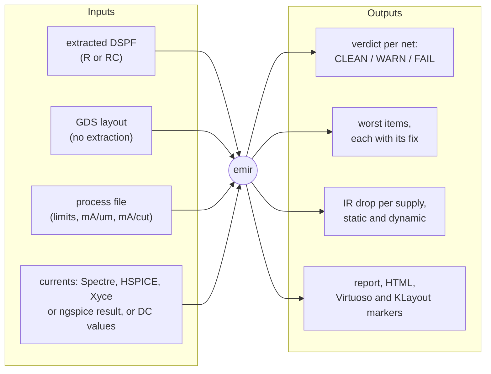

# EMIR

> **EMIR is a research project, provided as is, with no warranty or guarantee of
> accuracy. It is your responsibility to test and verify its results for your process,
> tools and design before relying on them.**

**Electromigration (EM) and IR-drop screening of extracted analog layout.**
EMIR reads an extracted resistor network (a DSPF, or the GDS layout itself) and the
currents that flow in it (a simulation, or DC values), and tells you which wire
segments and via arrays carry more current than the process allows, how far each
supply droops, and what to change: widen this wire to that width, add that many
cuts.

**Screening, not sign-off.** Every number EMIR prints screens a layout and says
where to look. Foundry-qualified EM/IR analysis remains the sign-off flow.

EMIR is built to be driven by AI agents. An agent reads [`AGENTS.md`](../AGENTS.md)
at the root of the repository, asks `emir next` what to run, runs each command with
`--format json`, branches on stable error codes, and relays `emir report` to you.
People run the same commands by hand, and read the same report.

## What it checks

- **EM on every wire segment and via**, for the three metrics the process file gives
  limits for: the average current (avg), the rms current (self-heating) and the peak.
  A wire is judged by its current per um of drawn width, a via by its current per cut.
- **IR drop** of every supply and ground net from where it is fed, from the average
  currents; the dynamic droop through the extracted capacitance when the currents are
  waveforms.
- **The input itself**, before any of that: `emir check` names every gap in the
  DSPF, the process file and the simulation result with a code and the command that
  fixes it, so a missing width or an unmapped layer never passes silently.

## Where the currents come from

| you have | EMIR does | page |
|---|---|---|
| a small block, its RC extraction simulated with every resistor current saved | reads each branch current directly (`--mode rcc`): exact | [Methods and modes](method-modes.md) |
| a big block (an ADC top, a PLL top), simulated C-only, plus an R-only extraction | pushes the device pin currents through the R grid by superposition (`--mode cc-grid`) | [Big blocks](big-blocks.md) |
| a whole chip | characterises each block once and screens the top with the blocks black-boxed | [Chip level](chip-level.md) |
| Spectre, HSPICE, Xyce or ngspice | writes the save lines and the name map, runs the simulator (Spectre and HSPICE with the person's go-ahead; UNVERIFIED until checked on site: `emir verify-sim --run`), and verifies the simulator's route on your machine first (`emir verify-sim`) | [Simulators](simulators.md) |
| Xyce or ngspice, no licensed tool | the same, end to end with open tools | [Open-source flow](open-source-flow.md) |
| only a GDS layout, on an open PDK | magic extracts the DSPF, every resistor with its geometry (`emir extract --tool magic`) | [Open-source flow](open-source-flow.md) |
| Cadence tools | plans and runs PVS + Quantus extraction, Spectre save lines, results on the layout in Virtuoso (UNVERIFIED until checked on site: `emir verify-sim --run`, or the on-site checks in `agent/cadence/`) | [Cadence flow](cadence.md) |

*How EMIR fits a flow, with the agent driving each stage.*

## Three ways in

1. **An AI agent.** Point the agent (Claude Code, Codex, Cursor or any other) at this
   repository: it reads [`AGENTS.md`](../AGENTS.md) and the playbooks in
   [`agent/playbooks/`](../agent/playbooks/). Clients without a shell use the MCP
   server, `emir mcp`. See [Driving EMIR from an agent](agents.md).
2. **The command line.** `emir selftest`, `emir next`, `emir check`, `emir run`,
   `emir report`. See [Getting started](getting-started.md) and the
   [command-line reference](cli-reference.md).
3. **Virtuoso.** An EMIR menu, a Screening form and an Explorer that ranks the worst
   segments and highlights them on the layout, read-only (UNVERIFIED until checked on
   site: the on-site checks in `agent/cadence/`). See [Cadence flow](cadence.md).

## Where to read next

| if you want to | read |
|---|---|
| install it and see it work in a minute | [Getting started](getting-started.md) |
| know what the numbers mean | [Concepts](concepts.md) |
| choose between rcc and cc-grid, and know how accurate each is | [Methods and modes](method-modes.md) |
| screen an ADC top or a PLL top | [Big blocks](big-blocks.md) |
| screen a chip from its blocks' pins and currents | [Chip level](chip-level.md) |
| bring your own PDK | [Onboarding a PDK](pdk-onboarding.md), [Process file reference](process-file-reference.md) |
| check that your extraction has what EMIR needs | [DSPF requirements](dspf-requirements.md) |
| know why to trust it, and where not to | [Validation](validation.md), [Limits](limits.md) |
| know which simulator does what, and how its route is verified on your machine | [Simulators](simulators.md) |
| look up an option or an error code | [Command line](cli-reference.md), [Error codes](errors.md) |

EMIR runs on Linux with Python 3.10 or newer; its core needs only numpy, SciPy and
PyYAML, and no licensed tool. It is licensed under the MIT License. Cadence, Virtuoso,
Spectre, Quantus and PVS are trademarks of Cadence Design Systems, Inc.; Calibre is a
trademark of Siemens; HSPICE and StarRC are trademarks of Synopsys. EMIR is not
affiliated with or endorsed by any of them.
